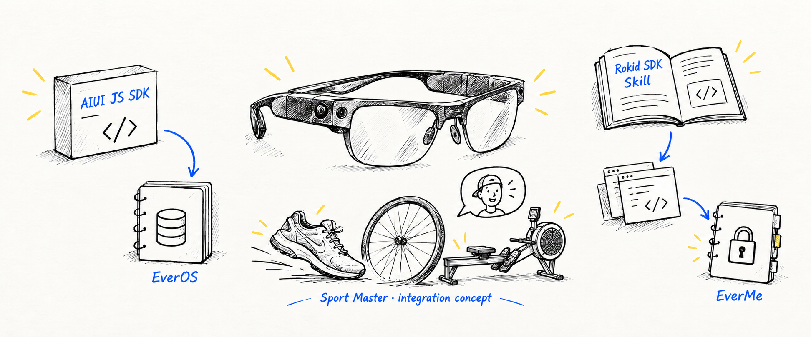
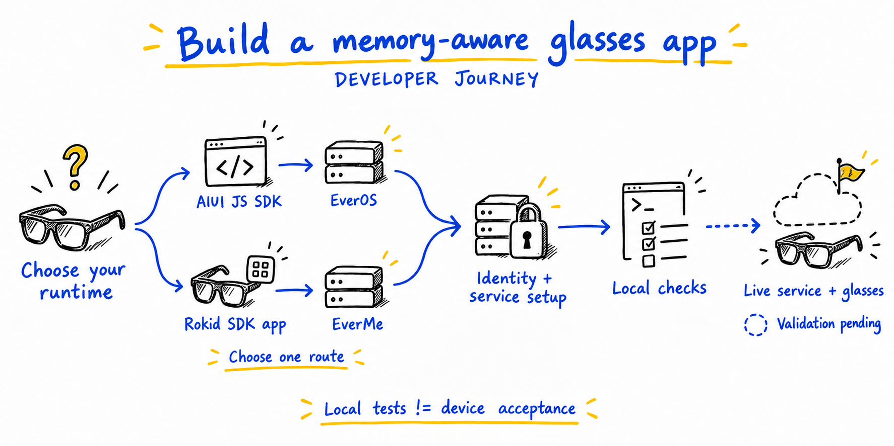
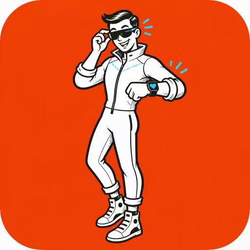
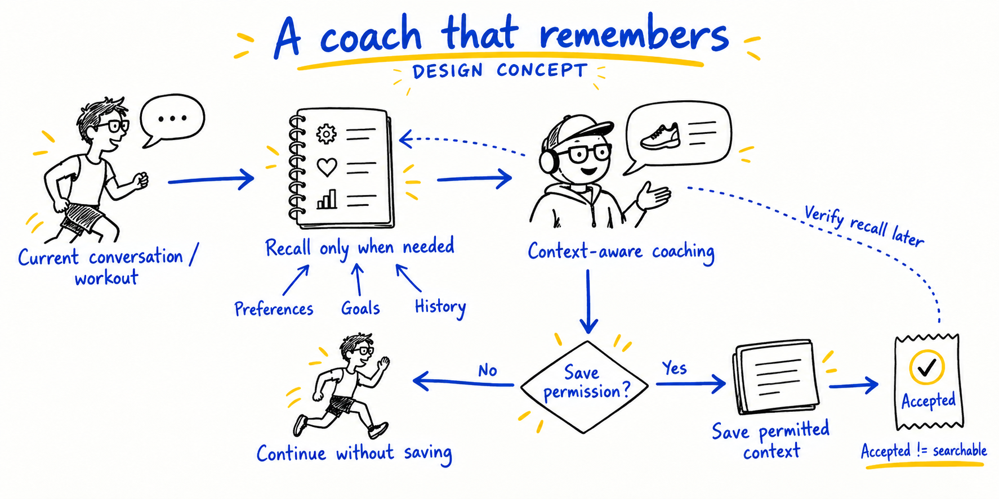
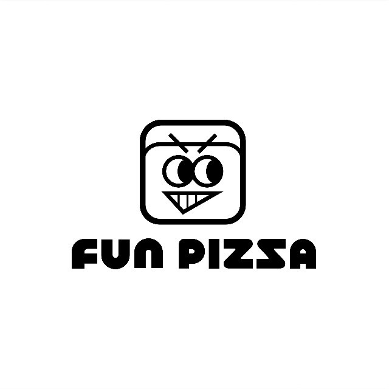

<div align="center">


&nbsp;&nbsp;


# Rokid × EverMind

### 为眼镜应用接入可复用的长期记忆

**AIUI JavaScript SDK · Rokid SDK × EverMe Skill · Sport Master 源码案例**

Reusable memory integration for glasses developers.

[](skills/aiui-everos-direct/sdk/README.md)
[](docs/validation.md)
[](#图文文档)
[](LICENSE)

[Skill 接入中心](skills/README.md) · [快速开始](#快速开始) · [运动大师案例](#运动大师案例) · [验证记录](#验证记录) · [维护方](#维护方)

**[简体中文](docs/rokid-memory-skills.md) · [English](docs/rokid-memory-skills.en.md) · [日本語](docs/rokid-memory-skills.ja.md) · [Français](docs/rokid-memory-skills.fr.md)**



</div>

<details>
<summary><strong>目录</strong></summary>

- [项目定位](#项目定位)
- [选择开发路线](#选择开发路线)
- [快速开始](#快速开始)
- [运动大师案例](#运动大师案例)
- [记忆如何参与训练](#记忆如何参与训练)
- [图文文档](#图文文档)
- [验证记录](#验证记录)
- [维护方](#维护方)
- [参与与许可](#参与与许可)

</details>

## 项目定位

把记忆接到眼镜应用时，开发者需要解决服务调用、身份隔离、授权回程和应用生命周期。本仓库把可复用的请求实现集中到 **AIUI JavaScript SDK**，并为 **Rokid SDK 应用**提供接入 EverMe 的开发 Skill，让新项目和已有应用都能从明确的接线位置开始。

| 可直接复用 | 如何帮助开发 |
| --- | --- |
| 一份 JavaScript 实现 | 统一 `add/search/flush/dispose`、响应解析、超时和 owner 检查，减少重复生成 HTTP client |
| 两条接入路线 | AIUI 使用 EverOS HTTP API；Rokid SDK 应用通过自有后端接用户授权的 EverMe MCP |
| 四语图文与公开源码 | 从路线、架构、授权和案例图进入实现，再用独立验收检查结果 |

> [!NOTE]
> AIUI Skill 是可选的开发指导；运行时调用的是 JavaScript SDK。Rokid SDK 路线提供实施 Skill，具体硬件 SDK 由开发者按目标设备选择。本仓库未提供通用 Android 二进制 SDK 或可直接安装的 APK。

## 选择开发路线

<table>
<tr>
<th width="50%">AIUI JavaScript SDK → EverOS</th>
<th width="50%">Rokid SDK 应用 → EverMe</th>
</tr>
<tr>
<td valign="top">

**在 AIUI 项目中直接复用 SDK。**

- 面向 Page / Widget / Agent Worker。
- 使用 `wx.request` 与运行时认证回调。
- 经自有认证网关访问 Cloud 或受保护的自建 EverOS v2。
- 在账号、授权或页面结束时清理实例。

[SDK 与完整用法](skills/aiui-everos-direct/sdk/README.md) · [可选 AIUI Skill](skills/aiui-everos-direct/SKILL.md)

</td>
<td valign="top">

**为眼镜端应用实施个人记忆接入。**

- 先核对型号、固件和实际 Rokid SDK。
- 复用业务登录与自有后端。
- 实施 OAuth、MCP 工具发现、刷新和解绑。
- 按目标设备验证可信浏览器与授权回程。

[Rokid SDK Skill](skills/rokid-sdk-everme/SKILL.md) · [设备与后端职责](skills/rokid-sdk-everme/references/android-backend.md)

</td>
</tr>
</table>



## 快速开始

### 1. 获取 SDK 或 Skill

**接入方案已按官方 AIUI Skill 的方式独立整理：[Skill 接入中心](skills/README.md) · [AIUI 安装与实施](skills/aiui-everos-direct/README.md) · [Rokid SDK 安装与实施](skills/rokid-sdk-everme/README.md)。** 每条路线可单独安装，助手从短 `SKILL.md` 按任务读取本目录参考；无需加载整个展示页。

运行时代码见 [SDK v0.1.0](https://github.com/EasonZhu1997/Rokid-EverMind-Skills/releases/tag/aiui-everos-sdk-v0.1.0)；更新后的完整 Skill 包见 [skills-2026.10.25](https://github.com/EasonZhu1997/Rokid-EverMind-Skills/releases/tag/skills-2026.10.25)。也可克隆仓库：

```sh
git clone https://github.com/EasonZhu1997/Rokid-EverMind-Skills.git
```

| 开发目标 | 选择的内容 |
| --- | --- |
| AIUI 应用接 EverOS | SDK ZIP / TGZ，或完整 `skills/aiui-everos-direct/sdk/` |
| 助手协助 AIUI 接线 | 完整 `skills/aiui-everos-direct/`（可选） |
| Rokid SDK 应用接 EverMe | 完整 `skills/rokid-sdk-everme/` 或同名 ZIP |

### 2. AIUI：导入同一份 JavaScript SDK

将整个 `sdk/` 复制到 AIUI 项目 `lib/everos-sdk/`，保留 `package.json` 和 `LICENSE`。应用提供 `memoryConfig`，包含服务地址、用户范围、运行时认证与 owner 有效性检查：

```js
import wx from 'wx';
import { createAIUIEverosClient } from '../../lib/everos-sdk/index.js';

// memoryConfig comes from the app's existing login and service configuration.
const memory = createAIUIEverosClient({ wx, ...memoryConfig });
const result = await memory.search({ query: 'preferred coaching style' });

// When this owner/session/page ends:
memory.dispose();
```

[完整配置与错误状态](skills/aiui-everos-direct/sdk/README.md) · [类型声明](skills/aiui-everos-direct/sdk/index.d.ts) · [AIUI 生命周期适配](skills/aiui-everos-direct/references/aiui-adapter.md)

### 3. Rokid SDK：让助手按现有工程实施

让支持 Skill 的编程助手读取整个 `skills/rokid-sdk-everme/`：

```text
使用 $rokid-sdk-everme，为我的 Rokid SDK 眼镜应用接入 EverMe。
先核对目标型号、SDK、业务登录和授权浏览器能力。
沿用现有后端，实施 OAuth、MCP、账号切换、刷新和解绑。
运行本地测试，分别报告真实服务和物理眼镜的验收结果。
```

> [!TIP]
> 先完成一个“按需检索 → 回答 → 获准保存”的小循环。共享 Cloud key 留在服务端；公开 AIX 不内置共享主密钥。

<div align="right"><a href="#rokid--evermind">返回顶部 ↑</a></div>

## 运动大师案例

<table>
<tr>
<td width="150" align="center" valign="middle">

</td>
<td valign="top">

### 运动大师 · Sport Master

面向智能眼镜的运动应用实践。公开的 **[AIUI Sport / AIUI-Sports-Agents](https://github.com/EasonZhu1997/AIUI-Sports-Agents)** 包含跑步、骑行与室内划船三个 AIUI 工程，展示教练交互、运动记录、记忆适配与上传队列的接线位置。

产品运营方：**上海方披萨软件科技有限公司**<br />
**Shanghai Fun Pizza Software Technology Co., Ltd.**

[公开源码](https://github.com/EasonZhu1997/AIUI-Sports-Agents) · [中文接入分析](docs/rokid-memory-skills.md#sport-master-case) · [上游 EverOS 案例页](https://github.com/EverMind-AI/EverOS/blob/5b0979b1b7f3a0cbe235756ff098515ec490753e/README.zh-CN.md#L323)

</td>
</tr>
</table>

| 源码入口（固定快照） | 可借鉴的实现边界 |
| --- | --- |
| [Run / Bike / Rower](https://github.com/EasonZhu1997/AIUI-Sports-Agents/tree/1f34da442a830cfa571881cd6d81cb4eee08cc84/apps) | 三套独立应用、Page 与生命周期组织 |
| [记忆接口与上下文](https://github.com/EasonZhu1997/AIUI-Sports-Agents/blob/1f34da442a830cfa571881cd6d81cb4eee08cc84/apps/smartrun/lib/coach_api.js#L175) | 请求构造、限长 `{memories, profile}` 与回答上下文 |
| [记录上传队列](https://github.com/EasonZhu1997/AIUI-Sports-Agents/blob/1f34da442a830cfa571881cd6d81cb4eee08cc84/apps/smartrun/lib/aiui_record_upload.js#L13) | FIFO、owner 检查、明确确认后删除 |

EverOS 官方 README 已将 AIUI Sports Agents 列为使用场景，并说明接入 EverOS 需要单独配置后端。这里的 SDK 接线仍是**拟接入设计**：公开源码快照使用原有后端契约，尚未迁移到本 SDK；后端接入、真实记忆与物理眼镜需要分别验证。

<details>
<summary><strong>查看 Sport Master 的拟接线图</strong></summary>


</details>

## 记忆如何参与训练

记忆适合为回答提供已获准使用的偏好、目标和历史背景。先复用相关上下文，有需要时再检索；当前训练读数与正式记录仍由原业务系统提供。下图是产品接入概念，不表示运动大师已经部署了这些记忆功能。



保存请求被接收或排队后，还需按服务语义分别核验提取与后续召回。云端不可用时，保留同一用户已有的本地功能。

## 图文文档

| 文档 | 适合谁 |
| --- | --- |
| [简体中文图解](docs/rokid-memory-skills.md) | 从路线、架构、授权时序、记忆流程到运动大师案例 |
| [English illustrated guide](docs/rokid-memory-skills.en.md) | English-speaking developers integrating either route |
| [日本語図解ガイド](docs/rokid-memory-skills.ja.md) | AIUI SDK・Rokid SDK経路を使う開発者 |
| [Guide illustré en français](docs/rokid-memory-skills.fr.md) | Développeurs qui intègrent le SDK AIUI ou la voie Rokid SDK / EverMe |
| [API 与响应状态](skills/aiui-everos-direct/references/api-v2.md) | 实现 EverOS v2 调用与回执处理 |
| [OAuth 与远程 MCP](skills/rokid-sdk-everme/references/oauth-mcp.md) | 实现 EverMe 发现、权限、token 生命周期与工具调用 |
| [验证结果与复验脚本](docs/validation.md) | 核对 SDK 交付、类型、网络与官方 AIUI 宿主兼容性 |

中、英、日、法共 **24 张技术图**保留可编辑源图；新增概念插画用于说明使用方式。[技术图来源](docs/assets/blue-ink/README.md) · [概念图与生成记录](docs/assets/concepts/README.md)

## 验证记录

以下为 **2026-10-24** 对 SDK `0.1.0` 的实际验收；顶部测试 badge 表示本地验收记录，并非 GitHub CI 或硬件认证。

| 验证层 | 结果 |
| --- | --- |
| SDK 单元测试 | 30 项通过 |
| 本机 HTTPS 协议场景 | 9 项通过；11 次实际请求 |
| 类型与消费方式 | TypeScript 严格检查、TGZ 安装、目录复制与独立 ECMAScript 上下文通过 |
| 官方 AIUI 工具与宿主 | AIX CLI 0.8.2 打包；Ink Web 0.19.1 / QuickJS 导入、初始化与生命周期防护通过 |
| 真实服务与设备 | EverOS 实服、EverMe OAuth 和物理眼镜尚未验证 |

```sh
node --test skills/aiui-everos-direct/scripts/*.test.mjs verification/sdk/network.test.mjs
```

[完整验证范围](docs/validation.md) · [复验方法](verification/sdk/README.md) · [原发布包来源](verification/sdk/release-provenance.json)

## 维护方

<table>
<tr>
<td width="190" align="center" valign="middle">

</td>
<td valign="middle">

### 上海方披萨软件科技有限公司

**Shanghai Fun Pizza Software Technology Co., Ltd.**<br />
品牌：**FUN PIZZA**<br />
作者与项目维护：[Eason / EasonZhu1997](https://github.com/EasonZhu1997)

围绕运动大师产品实践，分享眼镜应用、记忆接入方法、可复用代码与开发验证资料。

</td>
</tr>
</table>

## 参与与许可

欢迎通过 [Issue](https://github.com/EasonZhu1997/Rokid-EverMind-Skills/issues) 提交 SDK 版本、目标宿主、复现步骤与脱敏样例。协议和权限改动请附验证依据，设备结果请注明型号、固件与构建版本。

原创代码与说明使用 [MIT](LICENSE)。Rokid、EverMind、运动大师和 FUN PIZZA 的原始标志保留各自权利，**不在 MIT 授权范围内**。[品牌来源](docs/assets/brand/README.md) · [第三方说明](THIRD_PARTY_NOTICES.md)

首页借鉴 [EverOS 中文 README](https://github.com/EverMind-AI/EverOS/blob/5b0979b1b7f3a0cbe235756ff098515ec490753e/README.zh-CN.md) 的信息层级与导航方式。技术来源、案例与维护者按各自角色展示；本项目为社区分享，不表示 Rokid 或 EverMind 官方认证或商业合作背书。

<div align="right"><a href="#rokid--evermind">返回顶部 ↑</a></div>
