# Ajouter une mémoire à long terme aux applications Rokid

[简体中文](rokid-memory-skills.md) · [English](rokid-memory-skills.en.md) · [日本語](rokid-memory-skills.ja.md) · **Français**

<p>
  
  &nbsp;&nbsp;
  
</p>

Deux voies de développement sont proposées pour les lunettes : **un SDK JavaScript réutilisable pour AIUI**, ou **un Skill d’intégration EverMe pour les applications Rokid SDK**. Le Skill AIUI, facultatif, guide l’intégration ; à l’exécution, l’application importe le SDK versionné. Il n’est donc pas nécessaire de générer un nouveau client HTTP pour chaque projet.

## 1. Choisir une voie d’intégration

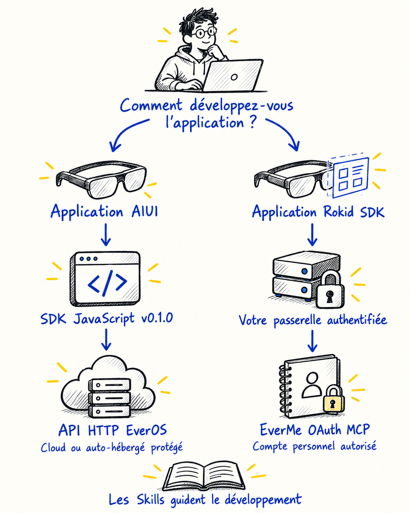

<details>
<summary>Source technique modifiable (Mermaid)</summary>

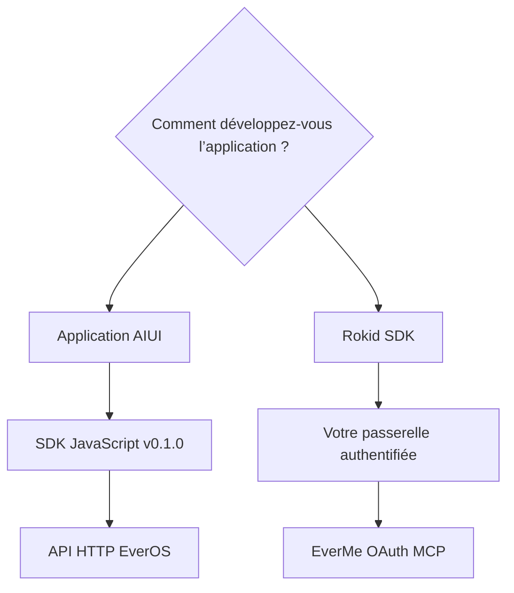

</details>

| Voie de développement | Point de départ | À préparer |
| --- | --- | --- |
| SDK JavaScript AIUI sur les lunettes | [SDK et utilisation](../skills/aiui-everos-direct/sdk/README.md) ; [Skill d’intégration](../skills/aiui-everos-direct/SKILL.md) facultatif | Version de l’hôte AIUI, passerelle HTTPS authentifiée, identifiants fournis à l’exécution, identité utilisateur stable |
| Application Rokid SDK sur les lunettes | [Skill Rokid SDK × EverMe](../skills/rokid-sdk-everme/SKILL.md) | SDK et appareil cibles, connexion à l’application, backend, navigateur d’autorisation de confiance et liaison du retour |

**EverOS** est le service de mémoire HTTP de la première voie. **EverMe** est le service lié au compte personnel de la seconde. Lorsqu’un projet emploie les noms « Evermate » ou « Evermind OS », confirmez le service réellement visé. Une clé API EverOS ne remplace pas l’autorisation de l’utilisateur EverMe.

Les dessins au stylo noir représentent les composants ; l’encre bleue explique leurs relations et quelques touches de jaune signalent les vérifications clés. Ces schémas décrivent une intégration et ne constituent pas une preuve de déploiement ou de validation sur un appareil physique.

## 2. AIUI : réutiliser le SDK JavaScript

Le schéma présente l’organisation recommandée pour une application distribuée à plusieurs utilisateurs. La passerelle appartient à votre application : elle authentifie son utilisateur et conserve la clé maîtresse du service amont sur le serveur.

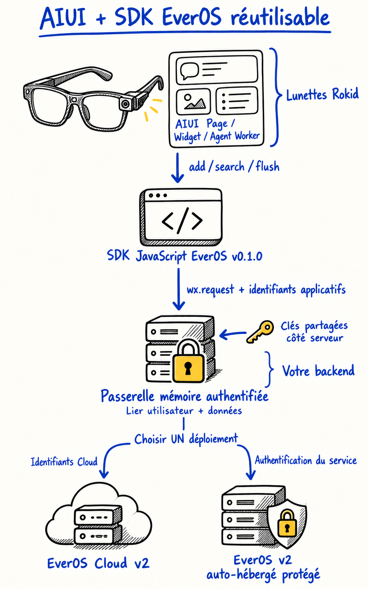

<details>
<summary>Source technique modifiable (Mermaid)</summary>

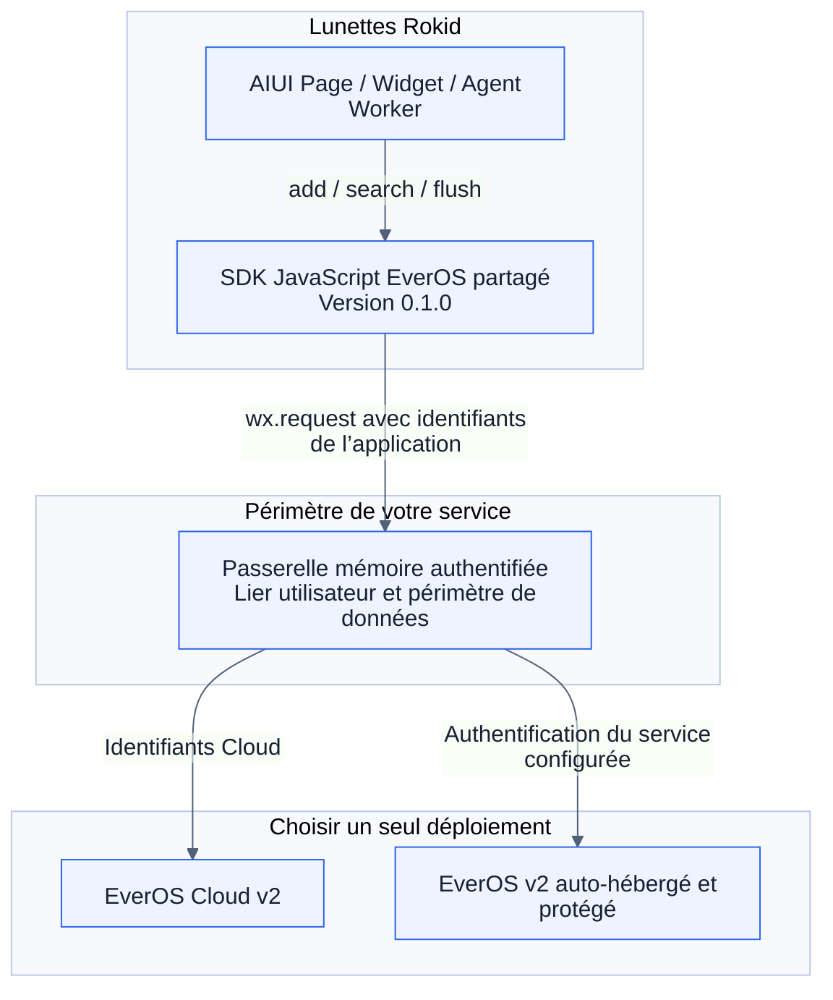

</details>

Pour un usage personnel en développement, un développeur peut fournir sa propre clé Cloud à l’exécution. **N’intégrez pas de clé partagée dans un AIX public.** « Direct » signifie qu’aucun APK ne sert de relais ; le parcours peut néanmoins inclure une passerelle. Un service local auto-hébergé sans protection ne convient pas comme point d’accès public, et `user_id` seul ne constitue pas un contrôle d’accès.

Commencez par une boucle simple : `POST /api/v2/memory/search`, génération de la réponse, puis envoi des événements de conversation autorisés avec `POST /api/v2/memory/add`. Utilisez `flush` à une limite de session lorsqu’une extraction est nécessaire. Fixez `app_id`, `project_id`, l’identité utilisateur et l’identité de session ; les horodatages des messages bruts sont exprimés en **millisecondes Unix**. Sur un déploiement auto-hébergé dépourvu d’embeddings, sélectionnez explicitement la recherche `keyword`.

Pour commencer : [versions et déploiement](../skills/aiui-everos-direct/references/versions-and-sources.md), [requêtes v2 et états de réponse](../skills/aiui-everos-direct/references/api-v2.md), [adaptateur AIUI](../skills/aiui-everos-direct/references/aiui-adapter.md).

### Réutiliser le SDK JavaScript

Le Skill s’appuie désormais sur un [SDK AIUI EverOS](../skills/aiui-everos-direct/sdk/README.md) versionné, au lieu de générer un client HTTP pour chaque projet. Cette implémentation unique regroupe la construction des requêtes, l’analyse des réponses, les contrôles d’identité, les délais d’expiration et la libération des ressources. Votre application fournit l’adresse du service, l’identité utilisateur, les identifiants à l’exécution et le raccordement au cycle de vie.

1. Téléchargez le SDK depuis la [release v0.1.0](https://github.com/EasonZhu1997/Rokid-EverMind-Skills/releases/tag/aiui-everos-sdk-v0.1.0), ou copiez le répertoire complet `skills/aiui-everos-direct/sdk/`.
2. Placez ce répertoire dans `lib/everos-sdk/` de votre projet AIUI, en conservant `package.json` et `LICENSE`.
3. Importez le module `.js` et configurez-le. L’extrait suivant suppose que l’application fournit `memoryConfig` ; les identifiants proviennent de sa fonction de rappel à l’exécution.

```js
import wx from 'wx';
import { createAIUIEverosClient } from '../../lib/everos-sdk/index.js';

const memory = createAIUIEverosClient({ wx, ...memoryConfig });
const result = await memory.search({ query: 'reminder preferences' });
```

`memoryConfig` contient `baseUrl`, `scope: {appId, projectId, userId, assistantId}`, une fonction synchrone `getAuthorization()` renvoyant la valeur Bearer complète, et `isCurrent()` vérifiant l’utilisateur ainsi que la génération d’autorisation capturés ; `timeoutMs` est facultatif. Fournissez ces valeurs à partir des mécanismes de connexion et de configuration du service déjà présents dans l’application. Ne placez pas de clés partagées dans le code source.

| Méthode du SDK | Responsabilité de l’application |
| --- | --- |
| `search({query, method, topK})` | Utiliser des résultats limités au seul utilisateur courant |
| `add({sessionId, messages})` | Soumettre les messages utilisateur/assistant autorisés, avec des horodatages en millisecondes |
| `flush({sessionId})` | Demander l’extraction à la limite de session appropriée |
| `dispose()` | Libérer l’instance à la fin de sa page, de son utilisateur ou de son autorisation |

Appelez `dispose()` dans `onUnload()` d’une Page ou `onDestroy()` d’un Widget ; créez une nouvelle instance si nécessaire. Une annulation ne peut pas annuler une écriture déjà envoyée. Ce SDK est un adaptateur AIUI communautaire maintenu dans ce dépôt ; son nom de paquet ne signifie pas qu’il est publié sur npm. [Code du SDK](../skills/aiui-everos-direct/sdk/index.js) · [Déclarations de types](../skills/aiui-everos-direct/sdk/index.d.ts).

## 3. Rokid SDK : utiliser le compte EverMe de l’utilisateur

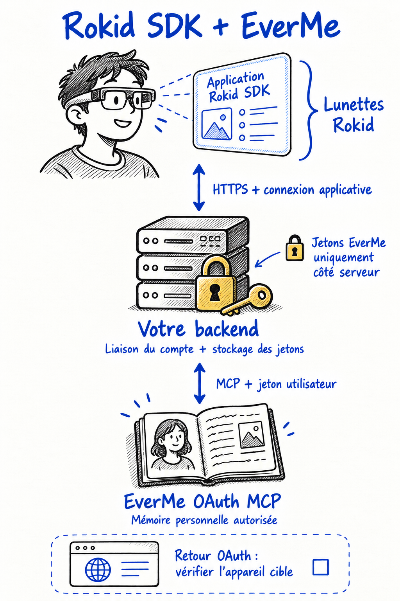

<details>
<summary>Source technique modifiable (Mermaid)</summary>

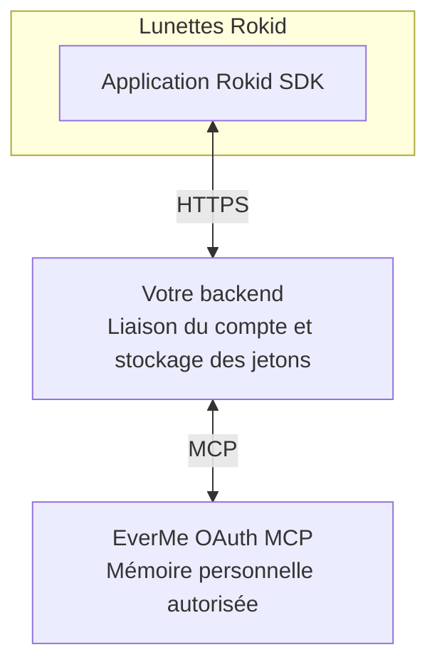

</details>

**Cette voie concerne une application exécutée sur les lunettes.** Vérifiez si la cible utilise Android directement sur les lunettes, CXR-S, ou CXR-L/CXR-M côté téléphone : ces modes de déploiement sont différents. L’application réalise sa propre intégration EverMe ; ce guide ne prétend pas qu’elle est intégrée au SDK officiel Rokid. Réutilisez et vérifiez la voix, l’affichage et les fonctions de l’appareil pour le SDK réellement utilisé. Consultez le [sélecteur officiel de SDK Rokid](https://developerdoc.rokid.com/sdk?lang=en).

Le navigateur d’autorisation peut fonctionner sur un autre appareil lié. Connectez-vous d’abord avec le même compte applicatif que sur les lunettes ; le backend doit valider la session du navigateur, son propriétaire, le parcours à usage unique, `state` et PKCE avant de permettre aux lunettes de ce propriétaire de consulter la connexion. Le simple scan d’un QR code n’établit pas l’identité du propriétaire, et ni `state` seul ni la seule interrogation du statut ne peuvent activer une autorisation.

EverMe ne crée ni votre connexion Bluetooth, ni la chaîne microphone, ni l’intégration TTS ou HUD. Réutilisez et vérifiez ces éléments dans votre application Rokid existante.

Avant l’enregistrement dynamique du client (**DCR**), faites enregistrer auprès d’EverMe les URL de callback exactes de vos environnements et convenez d’un `client_name` fixe. Découvrez les points d’accès OAuth officiels, conservez l’enregistrement du client et ne demandez que les scopes nécessaires. Enregistrez les scopes **effectivement accordés** par l’autorisation ; une écriture exige `mem:write`.

### Lier le retour d’autorisation à l’application qui l’a initiée

Le parcours ci-dessous propose un **retour App Link facultatif** pour les environnements où le navigateur externe, l’association vérifiée au domaine et le retour vers l’application d’origine ont été testés. Ce fonctionnement n’est pas garanti sur tous les modèles de lunettes et ne se transpose pas directement à une autorisation par QR code entre appareils. Dans les autres environnements, utilisez une session de navigateur de confiance liée au même propriétaire du compte applicatif, comme indiqué dans la référence du backend.

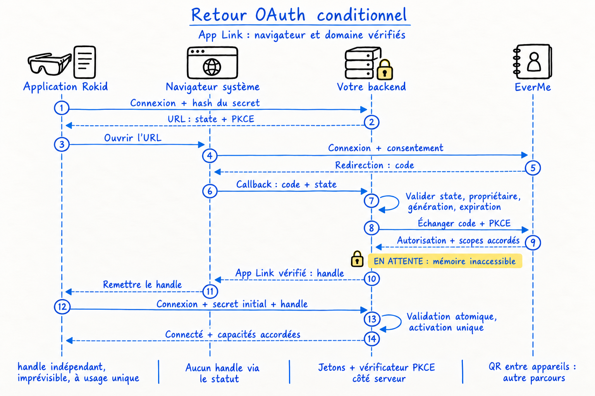

<details>
<summary>Source technique modifiable (Mermaid)</summary>

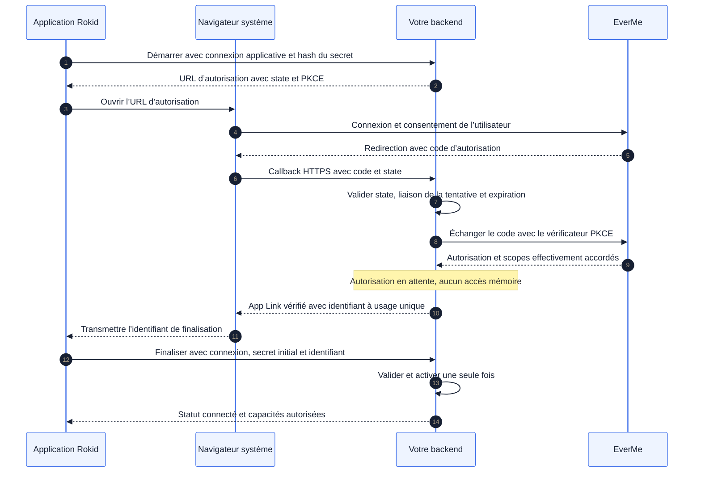

</details>

Le backend génère un identifiant de finalisation, ou `handle`, indépendant et imprévisible ; l’interrogation du statut ne permet pas de l’obtenir. Sans le secret de la tentative d’origine, une application ne peut pas finaliser la liaison. Les jetons EverMe et le vérificateur PKCE restent sur le backend. Transmettre une URL d’autorisation à une autre personne ne doit pas relier la mémoire de cette personne au compte applicatif de l’expéditeur.

Après activation, suivez `initialize → notifications/initialized → tools/list → tools/call`. Lisez les schémas des outils distants avant tout appel ; prenez en charge les réponses JSON et SSE. En cas de dépassement du délai d’une écriture ou d’un renouvellement, conservez l’état « résultat inconnu » au lieu de rejouer aveuglément la requête.

Références d’implémentation : [OAuth et MCP](../skills/rokid-sdk-everme/references/oauth-mcp.md), [responsabilités de l’application Rokid et du backend](../skills/rokid-sdk-everme/references/android-backend.md), [scénarios de validation](../skills/rokid-sdk-everme/references/acceptance.md).

## 4. Donner un rôle précis à la mémoire

Utilisez la mémoire pour retrouver les préférences pertinentes et les décisions antérieures. Réutilisez le contexte utile déjà disponible dans le tour courant ; ne lancez une recherche ciblée que si l’historique peut aider. En cas de conflit avec une mémoire plus ancienne, privilégiez les propos actuels de l’utilisateur et conservez les incertitudes. Si le service est indisponible, poursuivez le fonctionnement habituel de l’application sans inventer de souvenirs. Conservez les mesures en direct des appareils et les données métier faisant autorité dans leurs systèmes existants. La boucle suivante adapte le fonctionnement officiel de la mémoire à une application qui propose des choix explicites de partage des données.


<details>
<summary>Source technique modifiable (Mermaid)</summary>

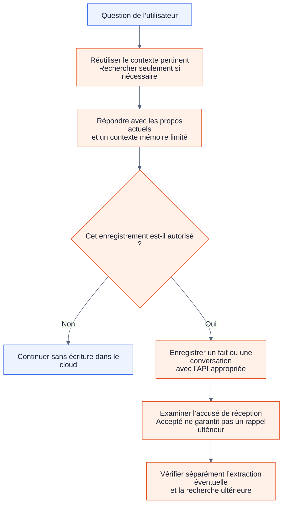

</details>

| Tâche | AIUI / EverOS v2 | Rokid SDK / EverMe MCP hébergé |
| --- | --- | --- |
| Lire l’historique pertinent | `memory/search` ; demander les profils si nécessaire | `mem_search` ; `mem_context` lit le Profile persistant, généralement une fois par session |
| Retenir une préférence explicite | Soumettre les messages autorisés avec `memory/add` | Privilégier `mem_save_fact` |
| Enregistrer une conversation | `memory/add` avec des messages et des identités d’expéditeur valides | `mem_save_turn` ; conserver les relations réelles entre appels d’outils lorsqu’elles sont prises en charge |
| Demander l’extraction | `memory/flush` une fois le travail précédent parvenu dans la chaîne de traitement | Utiliser le paramètre `flush` pris en charge par l’outil ; examiner son véritable accusé de réception |

Ce sont des équivalences conceptuelles, **pas des formats de requête interchangeables**. Découvrez le schéma authentifié d’EverMe. Un accusé de réussite de `mem_save_turn` ne prouve pas que le Profile a été mis à jour. Une écriture acceptée par l’un ou l’autre service ne prouve pas qu’une recherche ultérieure la retrouvera. Traitez les mémoires récupérées comme des données de contexte, jamais comme des instructions pouvant modifier les autorisations ou les points d’accès.

## 5. Essayer les Skills dans votre projet

```sh
git clone https://github.com/EasonZhu1997/Rokid-EverMind-Skills.git
```

Les développeurs AIUI doivent d’abord copier l’intégralité de `skills/aiui-everos-direct/sdk/` dans `lib/everos-sdk/` et l’importer comme décrit en section 2. Le Skill complet `skills/aiui-everos-direct` est un guide facultatif pour l’assistant. Pour la voie Rokid SDK, fournissez à l’assistant de programmation tout le dossier `skills/rokid-sdk-everme`, y compris les références, les agents et `LICENSE`.

**Consigne de démarrage AIUI**

```text
Utilise $aiui-everos-direct pour ajouter la mémoire EverOS à mon projet AIUI.
Lis docs/rokid-memory-skills.fr.md et réponds en français.
Examine les API actuelles de l’hôte et confirme Cloud ou v2 auto-hébergé.
Réalise une boucle rappel → réponse → enregistrement autorisé sans relais APK.
Réutilise le SDK JavaScript fourni ; écris seulement le raccordement propre à l’application.
Garde les identifiants partagés côté serveur et préserve l’isolation des utilisateurs.
Exécute les vérifications locales pertinentes et liste les essais service/appareil restants.
```

**Consigne de démarrage Rokid SDK**

```text
Utilise $rokid-sdk-everme pour ajouter EverMe à mon application Rokid SDK sur les lunettes.
Vérifie d’abord le SDK cible et les capacités du navigateur.
Lis docs/rokid-memory-skills.fr.md et réponds en français.
Réutilise la connexion de l’application et son backend. Vérifie l’enregistrement
du callback et du client_name, réalise l’autorisation dans le navigateur avec PKCE
et lie le retour à l’application d’origine. Découvre les outils MCP et traite
le renouvellement, la déconnexion et le changement de compte.
Termine l’implémentation et les tests locaux ; présente séparément les essais réels.
```

Si vous n’avez copié qu’un dossier de Skill, remplacez le chemin `docs/` dans la consigne par l’URL GitHub de ce guide.

| Étape | Éléments de preuve à recueillir |
| --- | --- |
| Implémentation locale | Tests reproductibles, isolation correcte des propriétaires et états d’erreur |
| Essai autorisé du service | Bon compte, scopes accordés, accusés de réception du backend et recherche dans une nouvelle session sans le contexte de la conversation d’origine |
| Essai de l’application et des lunettes | Build AIX/APK exact, firmware et modèle, comportement observé de la voix et de l’affichage |

Depuis la racine du dépôt, vérifiez le SDK avec `node --test skills/aiui-everos-direct/scripts/*.test.mjs`. Ces tests hors ligne ne prouvent pas que l’intégration fonctionne sur les lunettes. Consultez aussi l’[historique de validation](validation.md).

<a id="sport-master-case"></a>

## 6. Cas produit : 运动大师 / Sport Master · AIUI Sport

<p>
  
  &nbsp;&nbsp;
  
</p>

<strong>Produit et société exploitante :</strong> Sport Master (运动大师) est exploité par <strong>上海方披萨软件科技有限公司 / Shanghai Fun Pizza Software Technology Co., Ltd.</strong> Le code public AIUI Sport présenté ci-dessous illustre où intégrer la mémoire.

Le dépôt [AIUI-Sports-Agents d’Eason](https://github.com/EasonZhu1997/AIUI-Sports-Agents) fournit les projets publics Run, Bike et Rower. L’interface mémoire existante de l’application de course à pied permet d’examiner concrètement le point d’intégration du SDK :

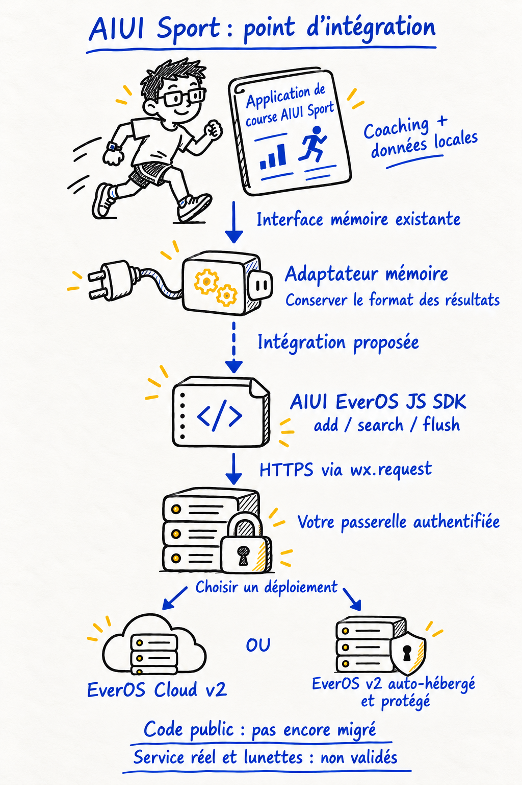

<details>
<summary>Source technique modifiable (Mermaid)</summary>

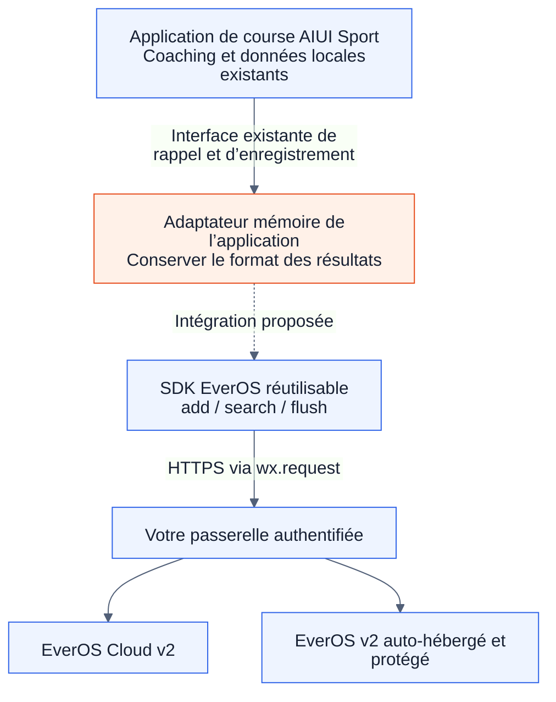

</details>

| Code public, figé à la version examinée | Ce qu’il permet d’étudier |
| --- | --- |
| [Projets Run / Bike / Rower](https://github.com/EasonZhu1997/AIUI-Sports-Agents/tree/1f34da442a830cfa571881cd6d81cb4eee08cc84/apps) | Des applications AIUI distinctes et la structure de leur cycle de vie |
| [Interface mémoire de l’application de course](https://github.com/EasonZhu1997/AIUI-Sports-Agents/blob/1f34da442a830cfa571881cd6d81cb4eee08cc84/apps/smartrun/lib/coach_api.js#L175) | Construction des requêtes, analyse bornée de `{memories, profile}` et ajout de contexte à la question |
| [File d’envoi](https://github.com/EasonZhu1997/AIUI-Sports-Agents/blob/1f34da442a830cfa571881cd6d81cb4eee08cc84/apps/smartrun/lib/aiui_record_upload.js#L13) | Traitement FIFO, contrôles du propriétaire et suppression seulement après confirmation explicite |

La liaison en pointillés représente une adaptation proposée au nouveau SDK. Cet instantané public utilise son propre contrat backend `memory-context` / `aiui-record` et n’a pas été migré vers ce SDK. Convertissez les résultats EverOS dans l’adaptateur de l’application, conservez les contrôles du propriétaire et les règles de file existants, puis validez séparément l’application obtenue. Ce cas permet d’inspecter le point d’intégration dans le code ; il ne démontre ni un déploiement EverMind réel ni une validation sur des lunettes physiques.

## Sources et périmètre

Sources vérifiées le **24 octobre 2026**. Ce guide communautaire concerne l’intégration à Rokid. Consultez les documents amont pour leur mode de déploiement et de transport respectif ; l’installation d’un plugin de bureau ou sa collecte automatique ne remplacent pas le consentement de l’utilisateur de l’application.

Le guide s’appuie sur les Skills officiels suivants, dont les versions sources sont figées pour la revue :

| Skill officiel | Principe repris dans ce guide |
| --- | --- |
| [EverOS search](https://github.com/EverMind-AI/Plugins/blob/3318dc1a2afcef3d3d804963941e8ce0bf9a3879/claude-code/skills/search/SKILL.md) | Déclencher le rappel à bon escient, garder une identité utilisateur cohérente et traiter honnêtement l’absence de résultats |
| [EverOS status](https://github.com/EverMind-AI/Plugins/blob/3318dc1a2afcef3d3d804963941e8ce0bf9a3879/claude-code/skills/status/SKILL.md) | Vérifier l’accès au service, l’identité et la configuration avant de diagnostiquer une panne |
| [EverMe memory-mcp](https://github.com/EverMind-AI/EverMe/blob/38afee5c89aad59f3c964fa861fc8fc6d003084a/plugins/memory-mcp/SKILL.md) | Expliquer l’utilité de chaque outil mémoire et vérifier le schéma réel du service hébergé |
| [EverMe memory-tools](https://github.com/EverMind-AI/EverMe/blob/38afee5c89aad59f3c964fa861fc8fc6d003084a/plugins/claude-code/skills/memory-tools.md) | Réutiliser le contexte déjà récupéré, cibler les recherches et distinguer les résultats de persistance |

Les hooks de bureau, les services sur l’interface de bouclage et les mécanismes de collecte automatique sont propres à ces plugins. Les variantes officielles du plugin EverMe diffèrent aussi par leurs outils et leur collecte ; la voie hébergée décrite ici suit le manuel OAuth et le résultat authentifié de `tools/list`. Nos deux Skills d’intégration sont des consignes de développement ; ils se distinguent d’un `agent_skill` extrait par EverOS à partir de l’historique d’exécution d’un agent.

- [Sources EverOS et références de déploiement](../skills/aiui-everos-direct/references/versions-and-sources.md)
- [Sources EverMe, manuel OAuth hébergé et différences de contrats](../skills/rokid-sdk-everme/references/sources.md)

Les textes originaux et les schémas de ce dépôt sont sous licence MIT ; les projets et documents amont conservent leurs licences respectives. Aucune certification Rokid ou EverMind n’est revendiquée. OAuth réel, opérations sur la mémoire cloud et comportement des appareils physiques nécessitent des validations distinctes.

*Remerciement pour la conception des schémas : 感谢 成都常顺鑫。*
