# Rokidアプリに長期記憶を組み込む

[简体中文](rokid-memory-skills.md) · [English](rokid-memory-skills.en.md) · **日本語** · [Français](rokid-memory-skills.fr.md)

<p>
  
  &nbsp;&nbsp;
  
</p>

グラス開発向けに、**AIUI用の再利用可能なJavaScript SDK**と、**Rokid SDKアプリ用のEverMe連携Skill**を提供します。AIUI Skillは任意の開発ガイドです。実行時は固定バージョンのSDKを使い、プロジェクトごとにHTTPクライアントを生成し直しません。

## 1. 連携経路を選ぶ

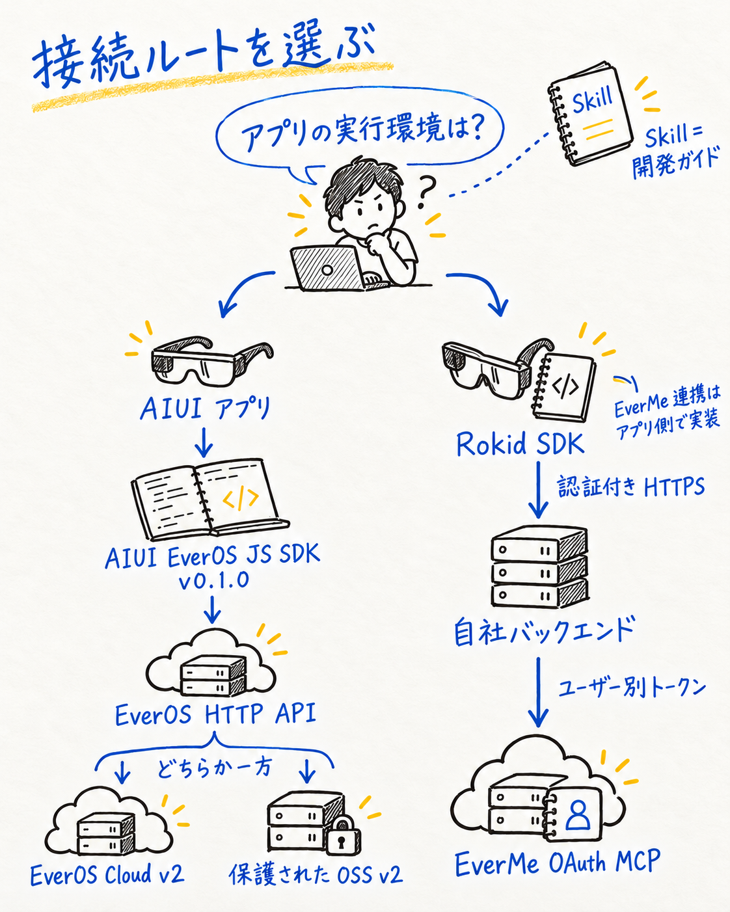

<details>
<summary>編集可能な技術ソース（Mermaid）</summary>

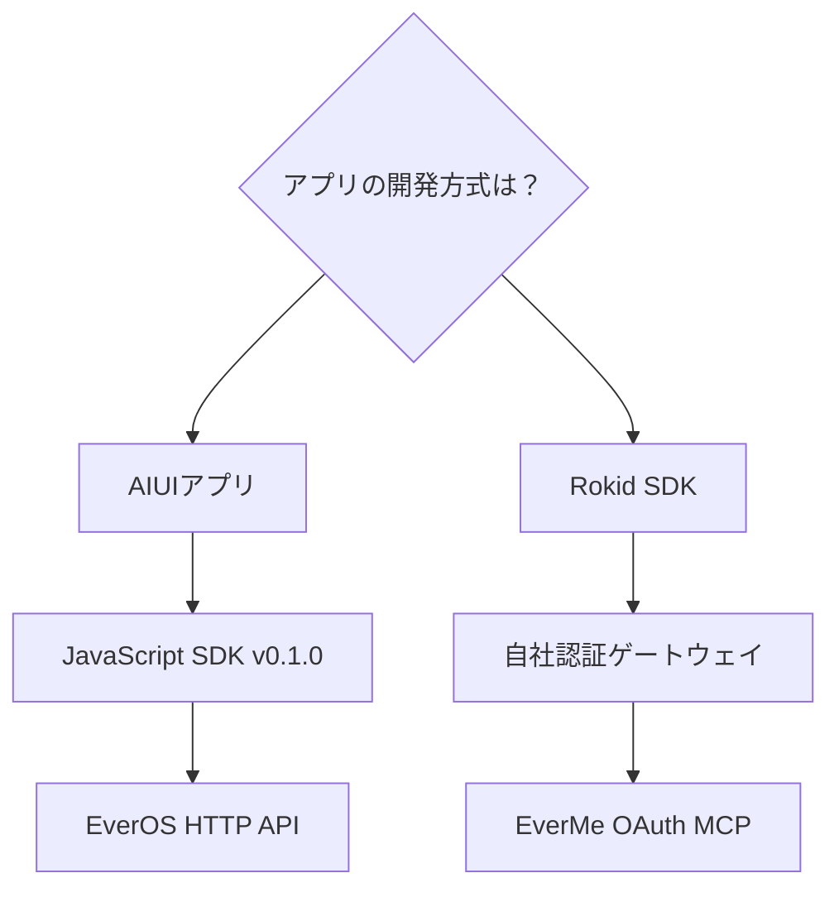

</details>

| 開発経路 | 開始点 | 先に用意するもの |
| --- | --- | --- |
| グラス上のAIUI JavaScript SDK | [SDKと使い方](../skills/aiui-everos-direct/sdk/README.md)・任意の[連携Skill](../skills/aiui-everos-direct/SKILL.md) | AIUIホスト、認証済みHTTPSゲートウェイ、実行時の認証情報、安定したユーザーID |
| Rokid SDKグラスアプリ | [Rokid SDK × EverMe Skill](../skills/rokid-sdk-everme/SKILL.md) | 対象SDKと端末、業務ログイン、バックエンド、信頼できる認可ブラウザーと戻り先の対応確認 |

**EverOS**は前者の経路で使うHTTP記憶サービス、**EverMe**は後者の経路で使う個人アカウント向けサービスです。プロジェクト内で「Evermate」「Evermind OS」と呼ばれている場合は、実際に接続するサービスを確認してください。EverOSのAPIキーは、EverMeユーザーの認可には使えません。

黒ペンは構成要素、青インクは関係、少量の黄色は重要な確認点を表します。図は連携設計であり、デプロイや実機検証の完了を示すものではありません。

## 2. AIUI：JavaScript SDKを再利用する

複数のユーザーに配布するアプリでは、次の構成を推奨します。ゲートウェイはアプリ側で用意し、アプリユーザーを認証します。接続先サービスのマスターキーはサーバーに保持します。

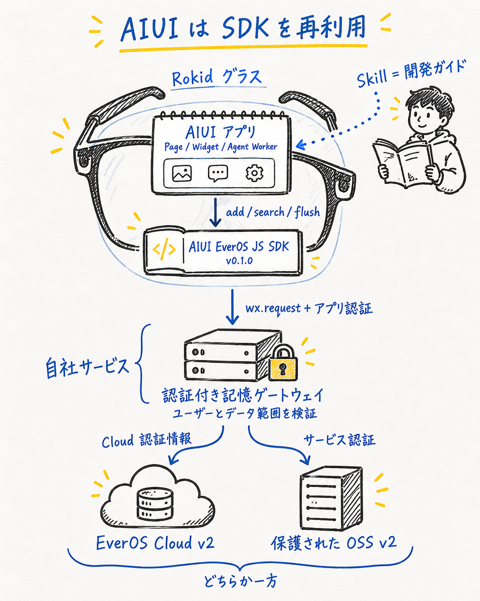

<details>
<summary>編集可能な技術ソース（Mermaid）</summary>

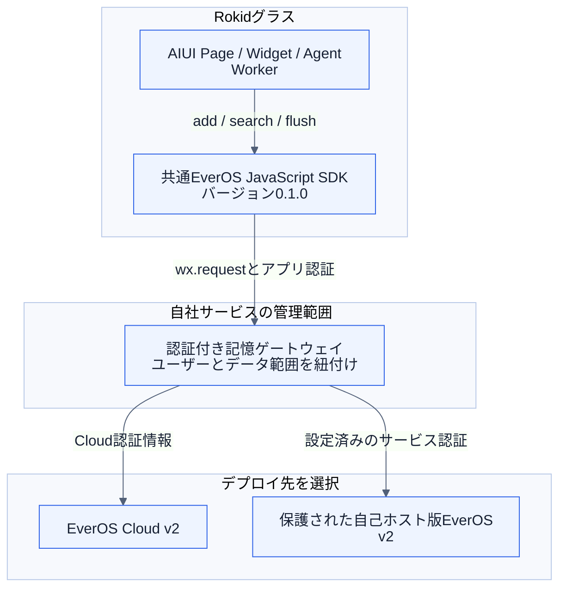

</details>

個人開発では、開発者自身のCloudキーを実行時に渡す方法もあります。**公開するAIXに共有キーを埋め込まないでください。** ここでの「直接接続」はAPKによる中継が不要という意味で、ゲートウェイを経由する構成も含みます。認証のないローカルの自己ホストサービスをそのまま公開用エンドポイントにはできません。また、`user_id`を指定するだけではアクセス制御になりません。

最初は`POST /api/v2/memory/search`で検索し、回答を生成してから、保存が許可された会話イベントを`POST /api/v2/memory/add`で送る流れを実装します。記憶の抽出が必要な場合は、セッションの区切りで`flush`を使います。`app_id`、`project_id`、ユーザーID、セッションIDを一貫させ、生のメッセージには**Unixミリ秒**のタイムスタンプを使ってください。埋め込みモデルを設定していない自己ホスト環境では、検索方式に`keyword`を明示します。

実装の入口：[バージョンとデプロイ](../skills/aiui-everos-direct/references/versions-and-sources.md)、[v2リクエストと応答状態](../skills/aiui-everos-direct/references/api-v2.md)、[AIUIアダプター](../skills/aiui-everos-direct/references/aiui-adapter.md)。

### JavaScript SDKを再利用する

Skillは、プロジェクトごとにHTTPクライアントを生成せず、バージョン管理された[AIUI EverOS SDK](../skills/aiui-everos-direct/sdk/README.md)を使うようになりました。リクエスト構築、応答解析、ユーザーの対応確認、タイムアウト、終了処理を1つの実装にまとめています。アプリ側では接続先、ユーザーID、実行時の認証情報、ライフサイクルを接続します。

1. [v0.1.0リリース](https://github.com/EasonZhu1997/Rokid-EverMind-Skills/releases/tag/aiui-everos-sdk-v0.1.0)からSDKを取得するか、`skills/aiui-everos-direct/sdk/`全体をコピーします。
2. AIUIプロジェクトの`lib/everos-sdk/`に配置し、`package.json`と`LICENSE`を保持します。
3. `.js`モジュールを直接インポートします。次の接続例の`memoryConfig`はアプリが用意し、認証情報は実行時のコールバックから渡します。

```js
import wx from 'wx';
import { createAIUIEverosClient } from '../../lib/everos-sdk/index.js';

const memory = createAIUIEverosClient({ wx, ...memoryConfig });
const result = await memory.search({ query: '通知方法の好み' });
```

`memoryConfig`には`baseUrl`、`scope: {appId, projectId, userId, assistantId}`、完全なBearer値を同期的に返す`getAuthorization()`、作成時のユーザー・認可世代が有効か確認する`isCurrent()`を設定します。`timeoutMs`は任意です。既存のログインとサービス設定から渡し、共有キーをソースに埋め込まないでください。

| SDKメソッド | アプリ側で担当すること |
| --- | --- |
| `search({query, method, topK})` | 現在のユーザーに対応する必要な結果だけを使う |
| `add({sessionId, messages})` | 保存が許可されたuser/assistantメッセージとミリ秒の時刻を渡す |
| `flush({sessionId})` | 適切なセッションの区切りで抽出を要求する |
| `dispose()` | ページ、ユーザー、認可の終了時にインスタンスを破棄する |

Pageでは`onUnload()`、Widgetでは`onDestroy()`で`dispose()`を呼び、再利用時は新しいインスタンスを作ります。キャンセルしても、すでに送信した書き込みをサーバー上で取り消せるとは限りません。本SDKはこのリポジトリで保守するコミュニティ製AIUIアダプターであり、パッケージ名はnpmでの公開を意味しません。[SDKソース](../skills/aiui-everos-direct/sdk/index.js) · [型定義](../skills/aiui-everos-direct/sdk/index.d.ts)。

## 3. Rokid SDK：ユーザーのEverMeアカウントを使う

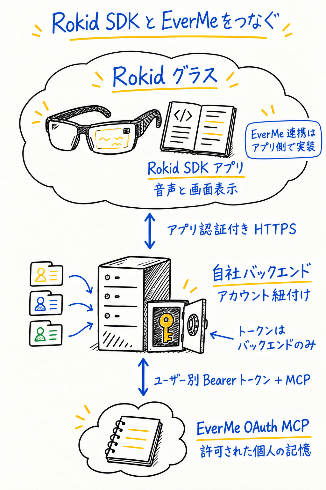

<details>
<summary>編集可能な技術ソース（Mermaid）</summary>

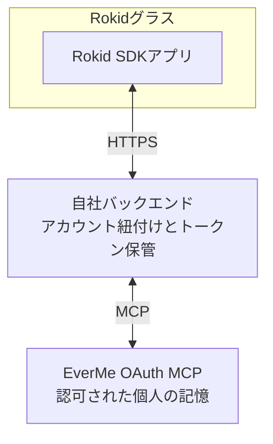

</details>

**この経路はグラス側アプリを中心に説明します。** 対象がベアメタルAndroid、CXR-S、スマートフォン側のCXR-L/CXR-Mのどれを使うか確認してください。同じ配置ではありません。EverMe連携層はアプリ側で実装し、公式Rokid SDKに内蔵されているとは扱いません。音声、表示、デバイス機能は実際のSDKで確認します。[Rokid公式SDK選択](https://developerdoc.rokid.com/sdk?lang=en)を参照してください。

認可用ブラウザーを別の紐付け済み端末で開く場合、グラスと同じ業務アカウントで先にログインします。バックエンドはブラウザーセッション、owner、一度限りのフロー、state、PKCEを検証し、そのownerのグラスだけに接続状態の照会を許可します。QRコードの読み取りだけでは所有者確認にならず、stateやポーリングだけで有効化してはいけません。

Bluetooth接続、マイク入力、TTS、HUD連携はEverMeの提供範囲に含まれません。既存のRokidアプリで使っている機能を再利用し、動作を確認してください。

動的クライアント登録（**DCR**）の前に、各環境の正確なコールバックURLをEverMeに登録し、固定の`client_name`を取り決めます。公式のOAuthエンドポイントをディスカバリーで取得し、クライアント登録情報を永続化したうえで、必要なスコープだけを要求します。認可時には、要求した値ではなく**実際に付与されたスコープ**を保存してください。書き込みには`mem:write`が必要です。

### 認可結果と開始元の対応を検証する

次の図は**任意のApp Link戻り経路**です。外部ブラウザー、ドメインの関連付け、開始元アプリへの復帰を対象環境で検証した場合だけ使います。すべてのグラスに保証された機能ではなく、別端末でのQR認可にそのまま適用できません。他の環境では同じ業務ownerに紐付いた信頼できるブラウザーセッションを使います。詳細はバックエンド資料を参照してください。

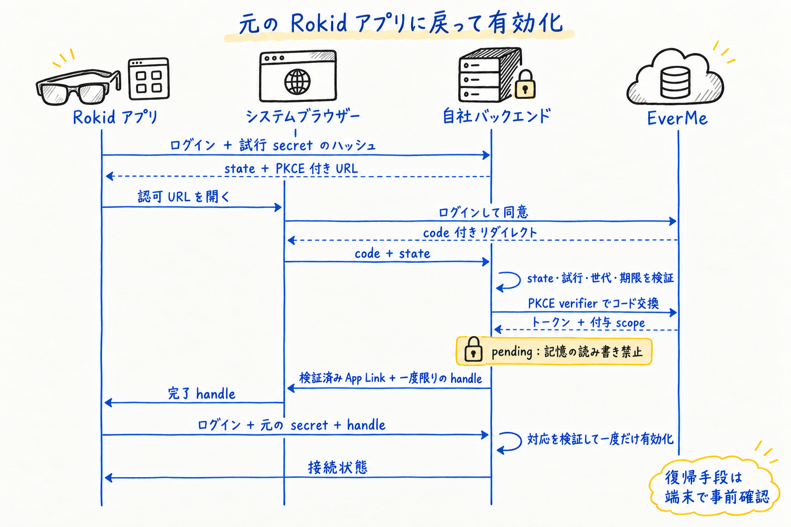

<details>
<summary>編集可能な技術ソース（Mermaid）</summary>

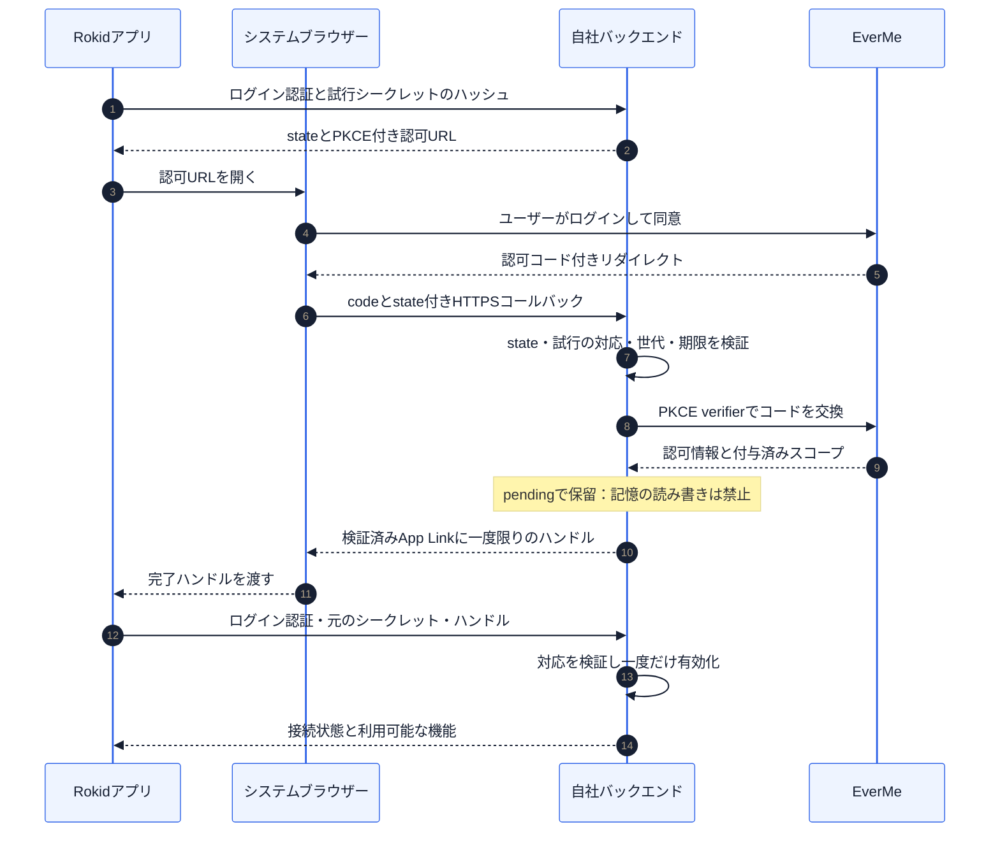

</details>

バックエンドは、独立した推測困難な完了ハンドルを生成します。接続状態のポーリングからこのハンドルを取得できる設計にしてはいけません。開始時の試行シークレットを持たないアプリは、紐付けを完了できません。EverMeのトークンとPKCE verifierはバックエンドに保持します。認可URLを別の人に転送しても、その人の記憶が送信者のアプリアカウントに接続されないことが必要です。

有効化後は`initialize → notifications/initialized → tools/list → tools/call`の順で進めます。実際のツールスキーマを確認してから呼び出し、JSONとSSEの両方の応答に対応してください。書き込みやトークン更新がタイムアウトした場合は、結果が不明であることを保持し、無条件に再送しないようにします。

実装資料：[OAuthとMCP](../skills/rokid-sdk-everme/references/oauth-mcp.md)、[Rokidアプリとバックエンドの役割](../skills/rokid-sdk-everme/references/android-backend.md)、[受け入れ検証シナリオ](../skills/rokid-sdk-everme/references/acceptance.md)。

## 4. 記憶に任せる役割を決める

記憶は、質問に関連する好みや過去の判断を思い出すために使います。このターンですでに得ている関連情報を再利用し、過去の情報が役立つときだけ、短いトピックで検索してください。古い記憶と今回の発言が食い違う場合は、ユーザーの今回の発言を優先し、不確かな情報は不確かなまま扱います。サービスが利用できない場合も、過去の事実を作り上げず、アプリの既存機能を継続します。リアルタイムのデバイス値や業務上の正規記録は、元のシステムで管理してください。次のループは公式の記憶ワークフローを参考にしつつ、アプリ側でデータ共有を明示的に選べる構成にしたものです。

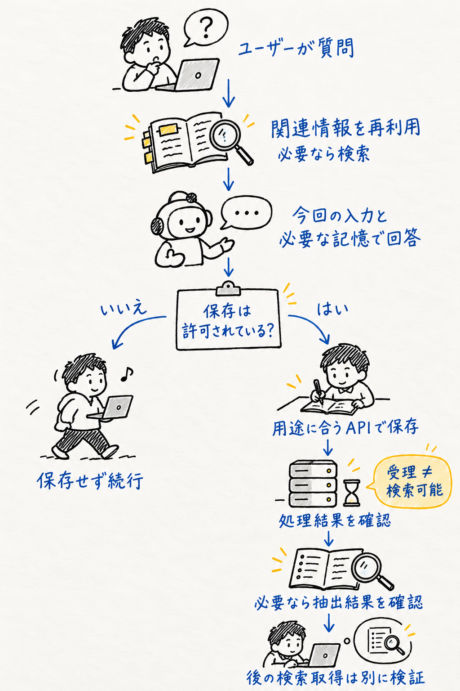

<details>
<summary>編集可能な技術ソース（Mermaid）</summary>

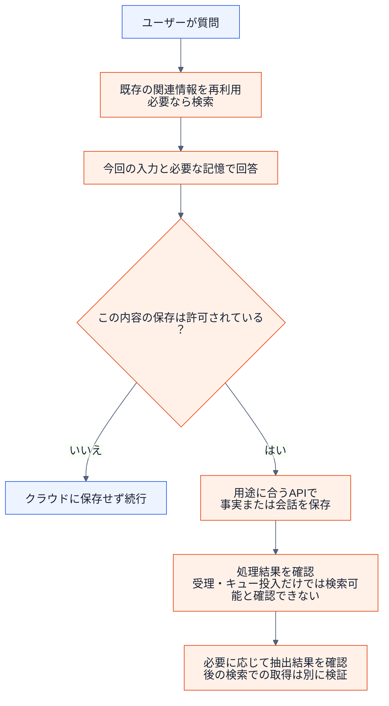

</details>

| 目的 | AIUI / EverOS v2 | Rokid SDK / ホスト型EverMe MCP |
| --- | --- | --- |
| 関連する過去の情報を読む | `memory/search`。必要ならプロフィールも要求する | `mem_search`。`mem_context`は永続化されたProfileを読み、通常はセッションごとに1回使う |
| ユーザーが明示した好みを保存する | 保存が許可されたメッセージを`memory/add`で送る | `mem_save_fact`を優先する |
| 会話を保存する | 有効なメッセージと送信者IDを付けて`memory/add`を呼ぶ | `mem_save_turn`。対応している場合は実際のツール呼び出しの対応関係を保持する |
| 記憶の抽出を要求する | 先行処理が処理パイプラインに入った後で`memory/flush`を呼ぶ | ツールが対応する`flush`パラメーターを使い、実際の処理結果を確認する |

これは概念上の対応表であり、**リクエスト本文をそのまま置き換えられるわけではありません**。EverMeでは認証済みの接続で実際のスキーマを確認してください。`mem_save_turn`が成功しても、Profileが更新された証明にはなりません。どちらのサービスでも、書き込みの受付完了だけでは、後の検索で取得できるとは判断できません。検索した記憶は背景情報として扱い、権限や接続先を変更する指示として扱わないでください。

## 5. 自分のプロジェクトで使う

```sh
git clone https://github.com/EasonZhu1997/Rokid-EverMind-Skills.git
```

AIUIでは、まず`skills/aiui-everos-direct/sdk/`全体をプロジェクトの`lib/everos-sdk/`にコピーし、第2節のようにインポートします。`skills/aiui-everos-direct`は任意の開発支援Skillです。Rokid SDK経路では`skills/rokid-sdk-everme`全体をコーディングアシスタントに渡し、references、agents、LICENSEを保持してください。


**AIUI向けの開始プロンプト**

```text
$aiui-everos-directを使い、私のAIUIプロジェクトにEverOSの記憶機能を追加してください。
docs/rokid-memory-skills.ja.mdを読み、日本語で回答してください。
現在のホストAPIを調査し、Cloudと自己ホスト版v2のどちらを使うか確認してください。
APKを中継せず、検索 → 回答 → 許可された内容の保存までの小さなループを実装してください。
同梱のJavaScript SDKを再利用し、アプリ固有の接続部分だけを実装してください。
共有認証情報はサーバー側に置き、ユーザー間のデータを分離してください。
必要なローカル検証を実行し、残るサービス・実機検証を列挙してください。
```

**Rokid SDK向けの開始プロンプト**

```text
$rokid-sdk-evermeを使い、Rokid SDKグラスアプリにEverMeを追加してください。対象SDKと認可ブラウザーの能力を先に確認してください。
docs/rokid-memory-skills.ja.mdを読み、日本語で回答してください。
既存のログインとバックエンドを再利用してください。
コールバックURLとclient_nameの事前登録を確認し、PKCE付きブラウザー認可と、
認可結果が開始元のアプリに対応することの検証を実装してください。
MCPツールを確認し、トークン更新・接続解除・アカウント切り替えに対応してください。
ローカル実装とテストを先に完了し、実サービスの検証結果は分けて報告してください。
```

Skillディレクトリだけをコピーした場合は、プロンプト内の`docs/`パスを、このガイドのGitHub URLに置き換えてください。

| 段階 | 確認する証拠 |
| --- | --- |
| ローカル実装 | 再現可能なテスト、ユーザー間の分離、エラー時の状態 |
| 認可済みの実サービス検証 | 正しいアカウント、付与されたスコープ、バックエンドの処理記録、元の会話文脈を持たない新しいセッションでの検索結果 |
| アプリとグラスの実機検証 | 対象AIX・APKのビルド、ファームウェアと機種、実際の音声・表示動作 |

SDKは、リポジトリのルートで`node --test skills/aiui-everos-direct/scripts/*.test.mjs`を実行して確認できます。これはオフラインテストであり、グラス上の連携が動くことの証明ではありません。[検証履歴](validation.md)も参照してください。

<a id="sport-master-case"></a>

## 6. 製品事例：运动大师 / Sport Master · AIUI Sport

<p>
  
  &nbsp;&nbsp;
  
</p>

<strong>製品と運営会社：</strong>运动大师（Sport Master）は、<strong>上海方披萨软件科技有限公司 / Shanghai Fun Pizza Software Technology Co., Ltd.</strong>が運営しています。以下ではAIUI Sportの公開ソースを使い、記憶機能の組み込み箇所を説明します。

[EasonのAIUI-Sports-Agents](https://github.com/EasonZhu1997/AIUI-Sports-Agents)では、ランニング、サイクリング、ローイング向けのAIUIアプリを公開しています。ランニングアプリの既存の記憶インターフェースを、SDKの組み込み箇所を検討する具体例として参照できます。

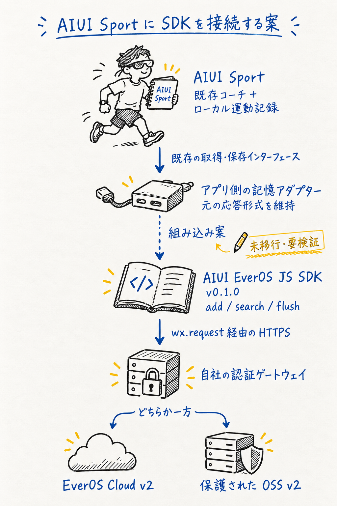

<details>
<summary>編集可能な技術ソース（Mermaid）</summary>

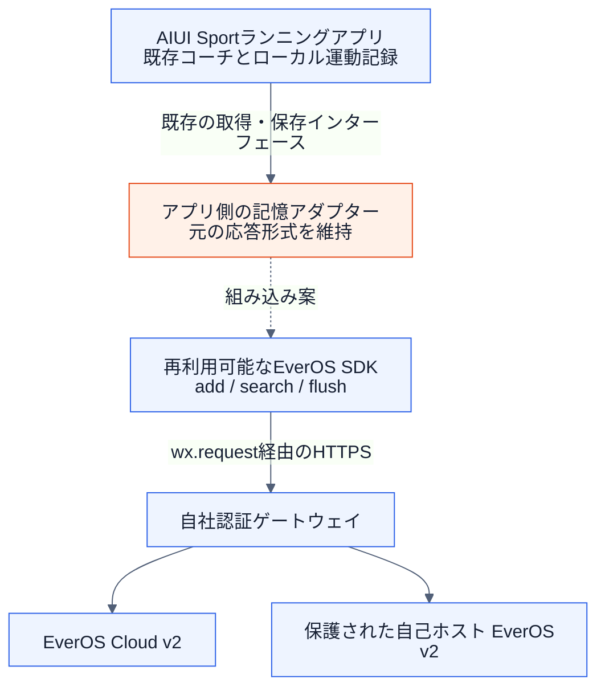

</details>

| 確認済みバージョンの公開コード | 参考になる点 |
| --- | --- |
| [Run / Bike / Rowerプロジェクト](https://github.com/EasonZhu1997/AIUI-Sports-Agents/tree/1f34da442a830cfa571881cd6d81cb4eee08cc84/apps) | 独立した3つのAIUIアプリとライフサイクル構成 |
| [ランニングアプリの記憶インターフェース](https://github.com/EasonZhu1997/AIUI-Sports-Agents/blob/1f34da442a830cfa571881cd6d81cb4eee08cc84/apps/smartrun/lib/coach_api.js#L175) | リクエスト構築、長さを制限した`{memories, profile}`の解析、質問への文脈追加 |
| [アップロードキュー](https://github.com/EasonZhu1997/AIUI-Sports-Agents/blob/1f34da442a830cfa571881cd6d81cb4eee08cc84/apps/smartrun/lib/aiui_record_upload.js#L13) | FIFO、所有者の一致確認、明示的な受領確認後の削除 |

破線は新SDKの組み込み案を表します。公開スナップショットは独自の`memory-context / aiui-record`バックエンド契約を使っており、本SDKへの移行は行われていません。EverOSの結果をアプリ側で変換し、元の所有者チェックとキュー規則を保ったうえで、対象アプリを検証してください。この例は実装箇所を確認できるソース資料であり、EverMind実サービスやグラスとの連携が検証済みであることを示すものではありません。

## 参考資料と適用範囲

確認日：**2026-10-24**。本ガイドは、コミュニティが作成したRokid連携向けの資料です。公式資料を使う際は、その資料が対象とするデプロイ方式と通信方式を確認してください。デスクトッププラグインのインストールや自動記録の仕組みを、APKユーザーの同意に置き換えることはできません。

以下の公式Skillを実際に参照しています。レビュー時のバージョンを固定したリンクです。

| 公式Skill | 本ガイドに取り入れた考え方 |
| --- | --- |
| [EverOS search](https://github.com/EverMind-AI/Plugins/blob/3318dc1a2afcef3d3d804963941e8ce0bf9a3879/claude-code/skills/search/SKILL.md) | 検索が役立つ場面を明確にする、一貫したユーザーIDを使う、結果がない場合に事実を作らない |
| [EverOS status](https://github.com/EverMind-AI/Plugins/blob/3318dc1a2afcef3d3d804963941e8ce0bf9a3879/claude-code/skills/status/SKILL.md) | 障害の原因を調べる前に、サービスへの到達性・ユーザーID・設定を確認する |
| [EverMe memory-mcp](https://github.com/EverMind-AI/EverMe/blob/38afee5c89aad59f3c964fa861fc8fc6d003084a/plugins/memory-mcp/SKILL.md) | 各記憶ツールの用途を明確にし、ホスト型サービスの実際のスキーマを検証する |
| [EverMe memory-tools](https://github.com/EverMind-AI/EverMe/blob/38afee5c89aad59f3c964fa861fc8fc6d003084a/plugins/claude-code/skills/memory-tools.md) | 取得済みの情報を再利用する、検索トピックを絞る、永続化の処理結果を区別する |

デスクトップのフック、ループバック上のサービス、自動記録は、それぞれのプラグイン固有の仕組みです。公式EverMeプラグイン間でも、ツールや記録方法は異なります。本ガイドのホスト型連携はOAuthマニュアルと認証済みの`tools/list`に従います。また、ここで提供する2つの連携開発Skillは、EverOSがエージェントの実行履歴から抽出する`agent_skill`とは別のものです。

- [EverOSのソースとデプロイ資料](../skills/aiui-everos-direct/references/versions-and-sources.md)
- [EverMeのソース、ホスト型OAuthマニュアル、契約の違い](../skills/rokid-sdk-everme/references/sources.md)

本リポジトリ独自の説明文と図にはMITライセンスが適用されます。参照先のプロジェクトや文書には、それぞれのライセンスが適用されます。RokidまたはEverMindによる認定を示すものではありません。実際のOAuth、クラウド上の記憶の読み書き、実機動作は別途検証が必要です。

*図のデザインへの謝辞：感谢 成都常顺鑫。*
