# Rokid 开发者：两条长期记忆接入路线

**简体中文** · [English](rokid-memory-skills.en.md) · [日本語](rokid-memory-skills.ja.md)

<p>
  
  &nbsp;&nbsp;
  
</p>

本仓库提供两条面向 Rokid 眼镜开发的接入路线：**AIUI 使用可复用 JavaScript SDK**，**Rokid SDK 应用使用 EverMe 接入 Skill**。AIUI Skill 是可选开发指导，运行时直接调用固定版本 SDK，不再为每个项目重新生成 HTTP client。

## 1. 先选路线

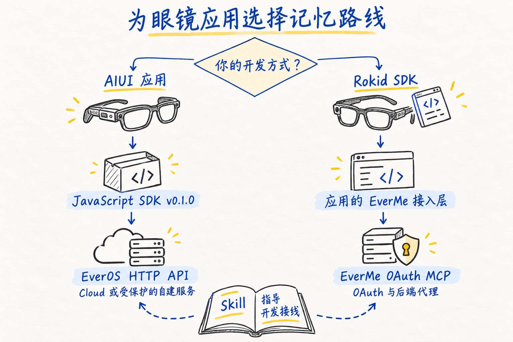

<details>
<summary>查看可编辑技术源图（Mermaid）</summary>

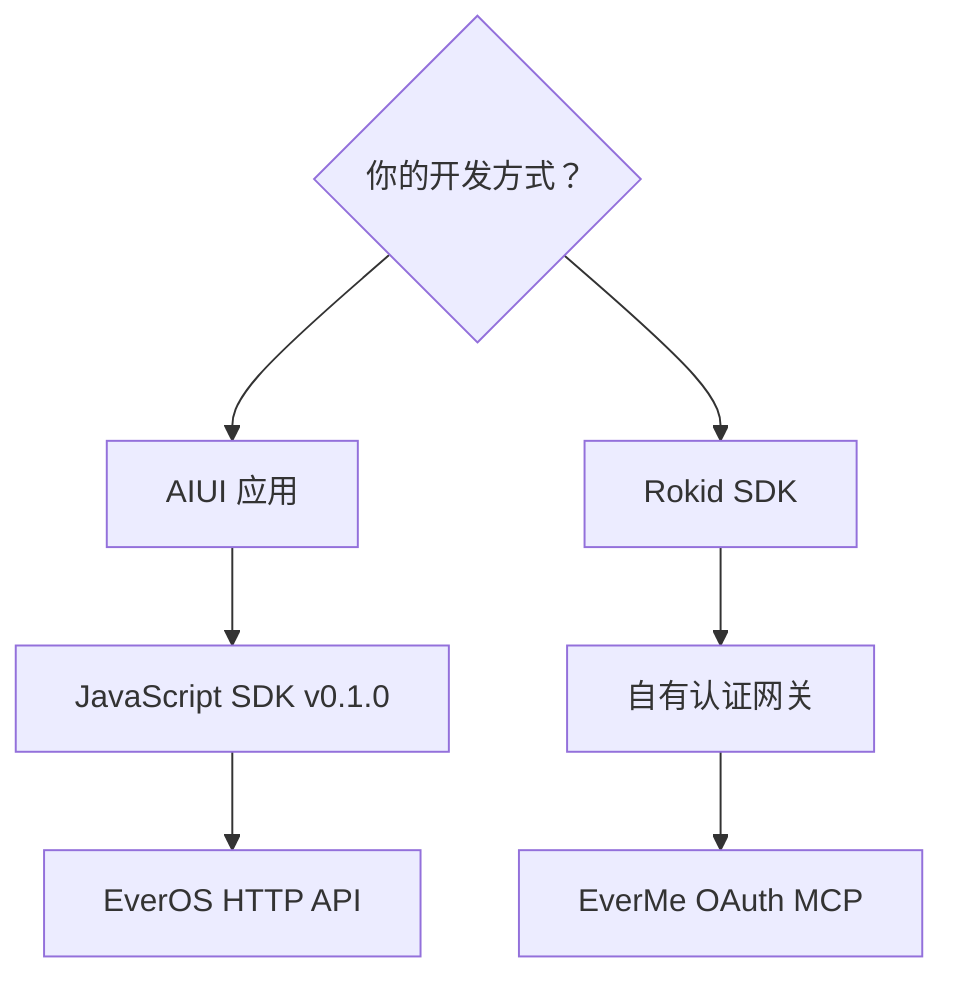

</details>

黑笔绘制组件，蓝墨说明关系，少量黄色强调检查点。图示是接入设计，不代表已上线或实机验证。

| 选择 | AIUI JavaScript SDK | Rokid SDK × EverMe |
| --- | --- | --- |
| 开发入口 | [SDK 与用法](../skills/aiui-everos-direct/sdk/README.md) | [Rokid SDK Skill](../skills/rokid-sdk-everme/SKILL.md) |
| 运行位置 | 眼镜上的 AIUI Page / Widget / Agent Worker | 目标设备支持的眼镜端 Android 应用 |
| 接入方式 | 复用 JS SDK，经认证网关访问 EverOS v2 | 应用接自有后端，经用户 OAuth 调用 EverMe MCP |
| 开发指导 | 可选 [AIUI Skill](../skills/aiui-everos-direct/SKILL.md) | `rokid-sdk-everme`，核对实际 SDK 与设备能力 |
| 先准备 | HTTPS 服务、运行时凭据、稳定用户身份 | 业务登录、后端、可信授权浏览器与回程绑定 |

AIUI 的“直连”表示不依赖手机 APK 转发，仍然需要眼镜可访问的服务。注册账号只是准备工作之一；服务开通、凭据、网络、用户隔离和真实读写都需要核验。普通应用的数据目录或 `user_id` 参数本身不构成访问控制。

Rokid SDK 路线需要先与 EverMe 登记各环境的准确回调 URL、约定固定的 `client_name`，再执行客户端动态注册。后端除校验 state 和 PKCE，还须验证授权结果回到原浏览器会话或原应用；只轮询“已连接”不足以防止转发授权链接造成账号错绑。具体要求见 Rokid SDK Skill 的 OAuth 与后端参考。

这里采用上游正式名称 **EverOS / EverMe**。“Evermind OS”“Evermate”等口头称呼需要先按用户提供的实际服务地址确认，不能推导出另一套 API。EverMe 公开 CLI/plugin 和远程 OAuth MCP 也可能提供不同工具；应读取目标服务的发现结果。

## 2. AIUI：复用 JavaScript SDK

下面是面向多用户分发的推荐设计。网关由你的应用实现：验证登录身份、固定用户数据范围，并在服务端保管上游主密钥。

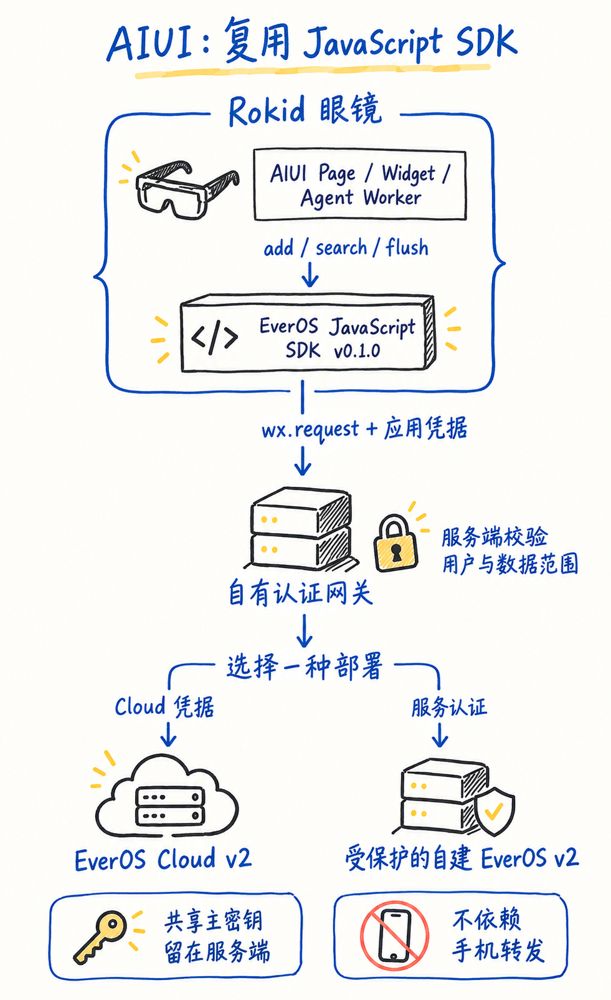

<details>
<summary>查看可编辑技术源图（Mermaid）</summary>

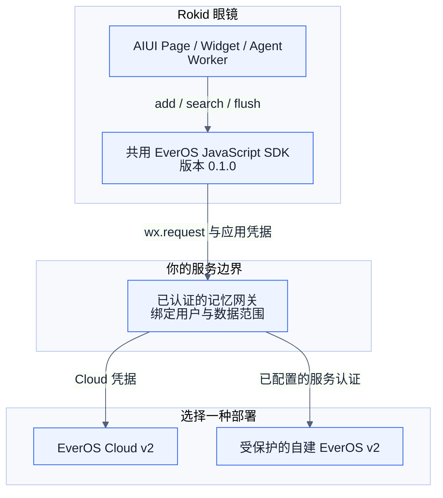

</details>

个人调试可在运行时提供自己的 Cloud key；**公开 AIX 不得内置共享 key**。网关不需要手机 APK。自建服务默认的无鉴权 localhost 入口不能直接当公网入口，眼镜上的 `127.0.0.1` 也不指向开发电脑。

先实现 `search → 生成回答 → add`，需要在会话结束时提取再调用 `flush`。固定 `app_id/project_id/user_id/session_id`，原始消息时间戳使用 **Unix 毫秒**；没有 embedding 的自建服务先明确用 `keyword` 搜索。

对应资料：[部署与版本](../skills/aiui-everos-direct/references/versions-and-sources.md)、[v2 请求与状态](../skills/aiui-everos-direct/references/api-v2.md)、[AIUI 适配](../skills/aiui-everos-direct/references/aiui-adapter.md)。

### 直接复用 JavaScript SDK

Skill 现在默认使用固定版本的 [AIUI EverOS SDK](../skills/aiui-everos-direct/sdk/README.md)，把 HTTP 请求、响应解析、身份检查、超时和清理集中在一份实现中。每个应用只接自己的服务地址、用户、运行时凭据和生命周期，减少重复生成与后续维护分叉。

1. 从 [v0.1.0 发布页](https://github.com/EasonZhu1997/Rokid-EverMind-Skills/releases/tag/aiui-everos-sdk-v0.1.0) 下载 SDK，或复制整个 `skills/aiui-everos-direct/sdk/`。
2. 放进 AIUI 项目的 `lib/everos-sdk/`，保留版本文件 `package.json` 与 `LICENSE`。
3. 直接导入 `.js` 模块。下面是接线片段：`memoryConfig` 由应用提供，认证通过运行时回调取得。

```js
import wx from 'wx';
import { createAIUIEverosClient } from '../../lib/everos-sdk/index.js';

const memory = createAIUIEverosClient({ wx, ...memoryConfig });
const result = await memory.search({ query: '偏好的提醒方式' });
```

`memoryConfig` 包含 `baseUrl`、`scope: {appId, projectId, userId, assistantId}`、同步返回完整 Bearer 值的 `getAuthorization()`，以及检查创建时用户/授权代次仍有效的 `isCurrent()`；可选 `timeoutMs`。这些值来自现有登录与服务配置，不能把共享 key 写进源码。

| SDK 方法 | 应用负责的内容 |
| --- | --- |
| `search({query, method, topK})` | 只为当前用户使用限长检索结果 |
| `add({sessionId, messages})` | 提交已获准保存的 user/assistant 消息及毫秒时间戳 |
| `flush({sessionId})` | 在合适的会话边界请求提取 |
| `dispose()` | 页面、用户或授权结束时清理对应实例 |

Page 在 `onUnload()`、Widget 在 `onDestroy()` 调用 `dispose()`；重新使用时创建新实例。取消请求不能撤销已经发出的服务端写入。本 SDK 是本仓库维护的社区 AIUI 适配版，包名不表示已经发布到 npm。[SDK 源码](../skills/aiui-everos-direct/sdk/index.js) · [类型声明](../skills/aiui-everos-direct/sdk/index.d.ts)。

## 3. Rokid SDK：使用用户自己的 EverMe 记忆

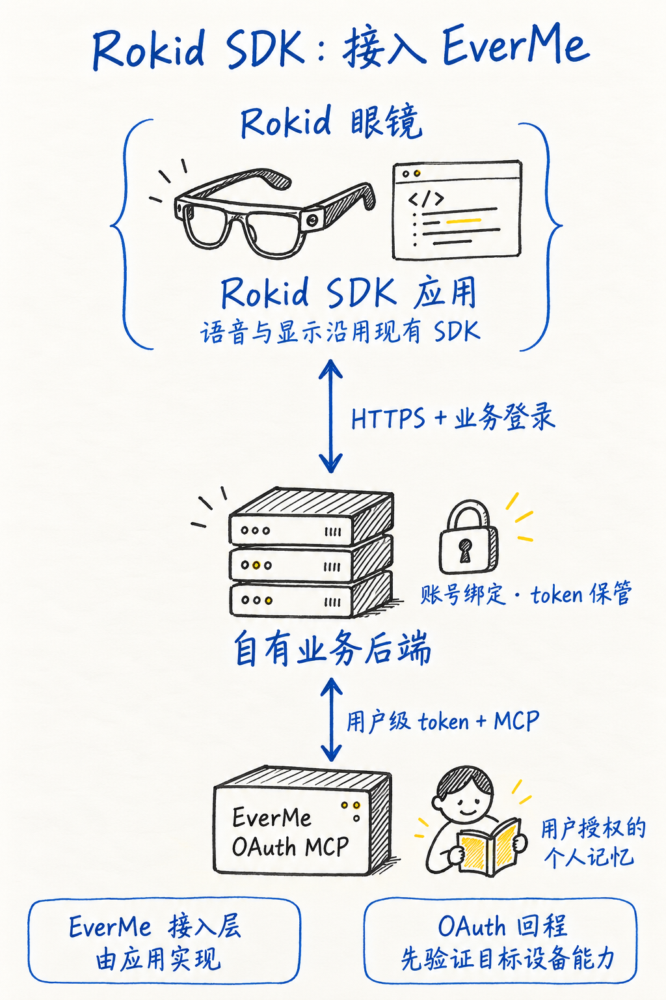

<details>
<summary>查看可编辑技术源图（Mermaid）</summary>

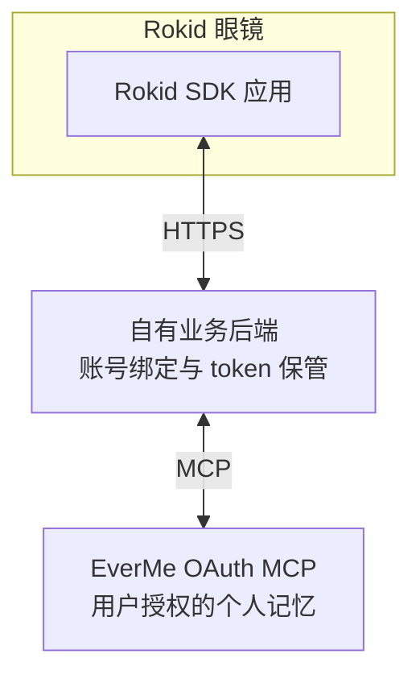

</details>

**Rokid SDK 路线以眼镜端应用为主。** 先按目标型号确认使用眼镜裸机 Android、CXR-S 或手机侧 CXR-L/CXR-M；它们不是同一种部署。这里的 EverMe 接入层由应用实现，不表示 Rokid 官方 SDK 自带 EverMe。语音、显示与设备通信沿用实际 SDK，并单独验证。参见 [Rokid 官方 SDK 选择](https://developerdoc.rokid.com/sdk?lang=en)。

授权浏览器可以在另一个已绑定设备上：用户先登录与眼镜相同的业务账号，后端验证浏览器会话、owner、一次性流程、state 和 PKCE，再允许该 owner 的眼镜查询连接状态。扫码本身不证明归属；不能只用 state 或轮询来激活授权。

EverMe 不负责建立蓝牙、麦克风采集、TTS 或 HUD；这些沿用已有 Rokid 应用通道并单独验证。先完成回调和固定名称登记，再做客户端动态注册（DCR）；按需要申请权限，并保存**实际授予的 scope**，写入需要 `mem:write`。

### 可选 App Link：确认回到原应用

下面是**可选 App Link 回程**，仅适用于目标环境已验证外部浏览器、域关联和返回原应用能力的情况。它不是所有眼镜都支持的默认功能；跨设备扫码不能直接套用。其他环境采用绑定同一业务 owner 的可信浏览器会话方案，详见后端参考。

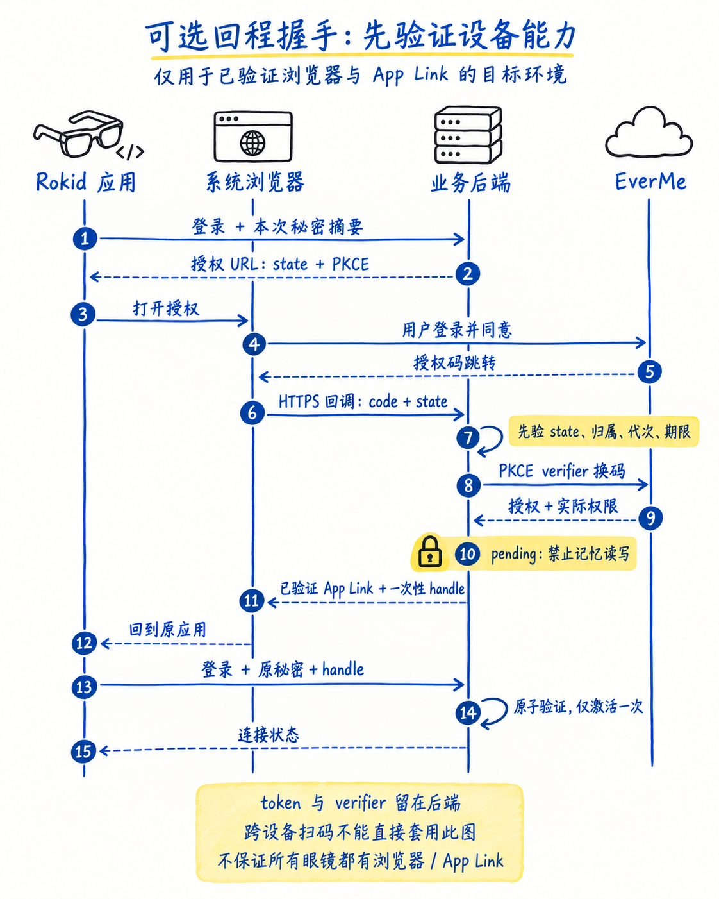

<details>
<summary>查看可编辑技术源图（Mermaid）</summary>

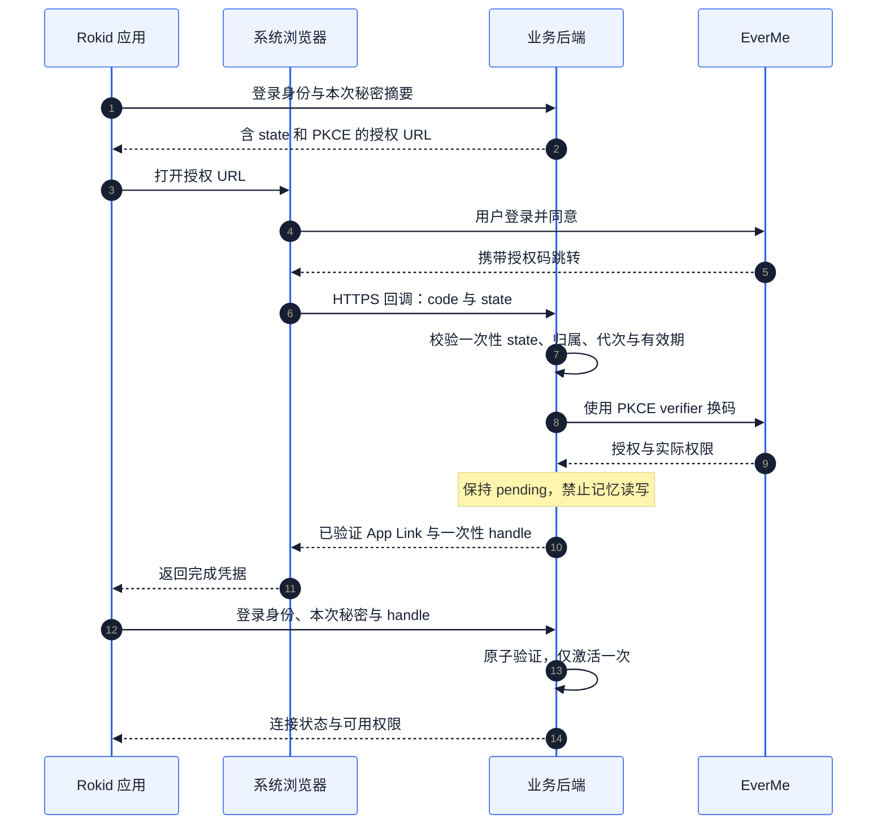

</details>

完成凭据由后端独立生成且不可预测，不能通过轮询取得。没有原本地 attempt 秘密的 应用无法完成绑定；EverMe token 和 PKCE verifier 始终保留在后端。转发授权链接给别人，不能把对方的记忆绑定到发起者账号。

激活后按 `initialize → notifications/initialized → tools/list → tools/call` 发现和调用工具，支持 JSON/SSE 响应。写入或刷新超时保留“结果未知”，不盲目重复发送。实现细节见 [OAuth/MCP](../skills/rokid-sdk-everme/references/oauth-mcp.md)、[Rokid 应用与后端](../skills/rokid-sdk-everme/references/android-backend.md)、[验收场景](../skills/rokid-sdk-everme/references/acceptance.md)。

## 4. 一次对话怎样使用记忆

记忆负责召回相关偏好和历史决定。先复用本轮已有的相关上下文，确有需要时再用短主题搜索；旧记忆与用户本次陈述冲突时，优先本次陈述并保留不确定性。服务不可用时继续原功能，不编造历史。实时设备读数、正式日程和执行记录保留在原业务系统。下图把官方 Skill 的上下文与检索思路适配到有明确数据同意的应用。

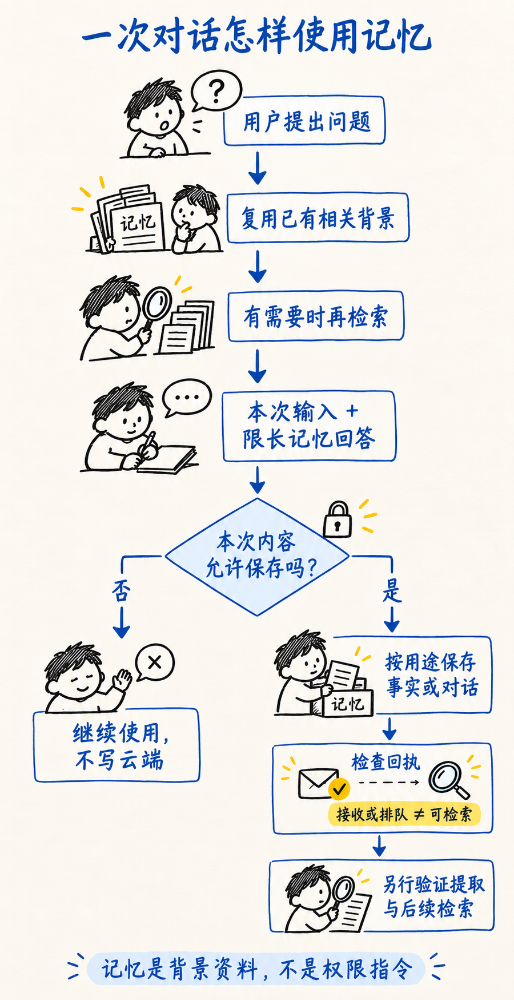

<details>
<summary>查看可编辑技术源图（Mermaid）</summary>

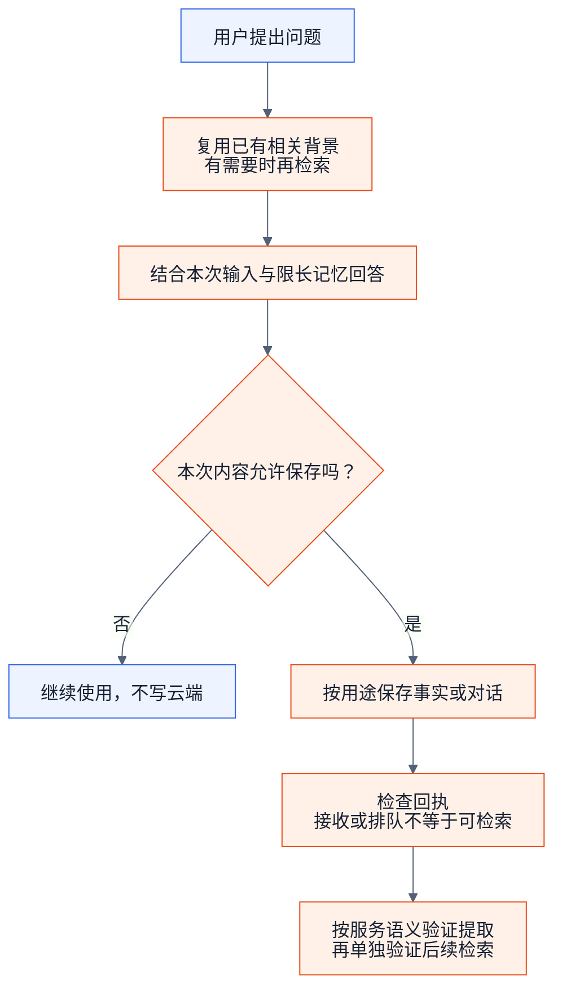

</details>

| 目的 | AIUI / EverOS v2 | Rokid SDK / 托管 EverMe MCP |
| --- | --- | --- |
| 读取相关历史 | `memory/search`，按需包含 profile | `mem_search`；`mem_context` 读取持久 Profile，通常每会话一次 |
| 记住明确偏好 | `memory/add` 提交获准保存的消息 | 优先 `mem_save_fact` |
| 保存对话 | `memory/add`，保持合法消息与说话者身份 | `mem_save_turn`，保留真实工具往返关系 |
| 请求提取 | 确认前序消息进入处理管线后 `memory/flush` | 按实际 schema 使用 `flush` 参数并核对回执 |

这是用途对照，不是可互换的请求体。`mem_save_turn` 成功不证明 Profile 更新；两种服务的“接收成功”都不能直接写成“下次一定能召回”。记忆内容是背景数据，不得用于改写权限或请求地址。

## 5. 取得与使用

```sh
git clone https://github.com/EasonZhu1997/Rokid-EverMind-Skills.git
```

AIUI 开发者优先复制整个 `skills/aiui-everos-direct/sdk/` 到项目 `lib/everos-sdk/`，直接按第 2 节导入；需要助手协助接线时，再提供可选的 `skills/aiui-everos-direct`。Rokid SDK 开发者复制整个 `skills/rokid-sdk-everme` 给编程助手读取。不要只复制一个 `SKILL.md`，保留 references、agents 与 LICENSE。


AIUI 调用示例：

```text
使用 $aiui-everos-direct，为我的 AIUI 项目接入 EverOS 长期记忆。
不依赖手机 APK。先核对现有 AIUI 网络 API、实际 EverOS 服务版本和用户隔离，
实现记忆写入与检索，给出可运行验证及未完成的眼镜实测项。
直接复用包内 JavaScript SDK，只编写当前应用的认证、身份和生命周期接线。
```

Rokid SDK 调用示例：

```text
使用 $rokid-sdk-everme，为我的 Rokid SDK 眼镜应用接入 EverMe。先确认目标 SDK 与授权浏览器能力。
沿用现有账号和后端，实现系统浏览器授权、PKCE、MCP 工具发现、刷新和解绑，
并验证账号切换、取消授权、网络超时与重复回调。先完成本地实现和测试。
```

排查示例：

```text
按对应 Skill 检查：写入请求成功但检索不到，或应用解绑后旧请求仍返回记忆。
先区分服务接受、处理完成、检索可见和客户端回调归属，不要直接循环重发写入。
```

| 阶段 | 要取得的证据 |
| --- | --- |
| 本地实现 | 可复现测试、账号隔离和错误状态 |
| 获准的服务联调 | 正确账号、实际权限、后端回执，以及不携带原聊天上下文的新会话召回 |
| 应用与眼镜联调 | 明确 AIX/APK 构建、固件/型号、语音与显示观察 |

从仓库根目录运行 `node --test skills/aiui-everos-direct/scripts/*.test.mjs` 可检查 SDK。这是离线测试，不是眼镜接入成功证据。三种语言说明使用同一组 Skill 标识与共享技术参考。

## 6. 公开案例：AIUI Sport

作者公开的源码案例 [AIUI-Sports-Agents](https://github.com/EasonZhu1997/AIUI-Sports-Agents) 提供跑步、骑行和室内划船三套 AIUI 应用。以跑步应用为例，可以从它已有的记忆接口边界理解 SDK 的接入位置：

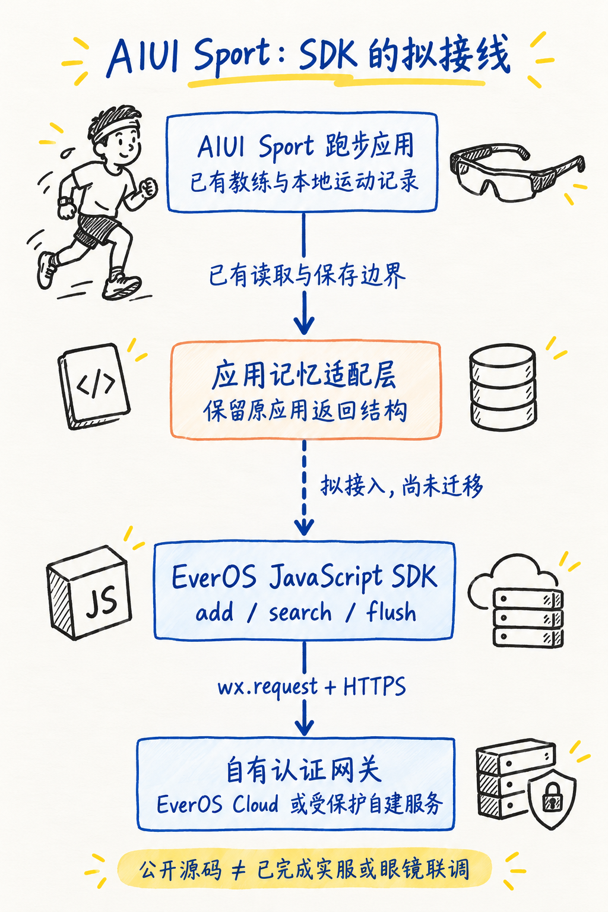

<details>
<summary>查看可编辑技术源图（Mermaid）</summary>

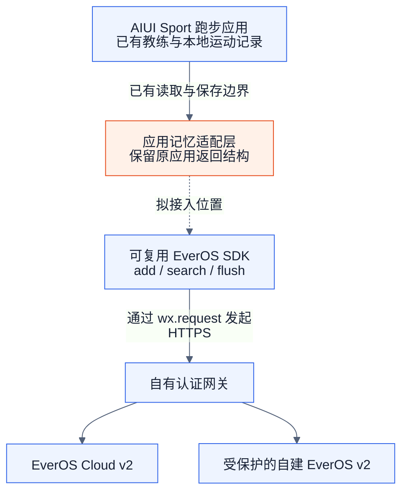

</details>

| 固定到已核对版本的公开代码 | 可以借鉴什么 |
| --- | --- |
| [Run / Bike / Rower 工程](https://github.com/EasonZhu1997/AIUI-Sports-Agents/tree/1f34da442a830cfa571881cd6d81cb4eee08cc84/apps) | 三套独立 AIUI 应用及其生命周期结构 |
| [跑步应用记忆边界](https://github.com/EasonZhu1997/AIUI-Sports-Agents/blob/1f34da442a830cfa571881cd6d81cb4eee08cc84/apps/smartrun/lib/coach_api.js#L175) | 请求构造、限长 `{memories, profile}` 解析与问题上下文组装 |
| [上传队列](https://github.com/EasonZhu1997/AIUI-Sports-Agents/blob/1f34da442a830cfa571881cd6d81cb4eee08cc84/apps/smartrun/lib/aiui_record_upload.js#L13) | FIFO、owner 检查和明确确认后才删除 |

图中虚线表示新 SDK 的拟接线。该公开快照使用自己的 `memory-context / aiui-record` 后端契约，尚未迁移到本 SDK；适配时需要转换 EverOS 结果，保留原有身份和队列规则，再验证目标应用。源码案例让接入位置可检查，不把它表述成已经完成 EverMind 实服或眼镜联调的成果。

## 来源与本次分享范围

包含可执行工作流程、版本与协议差异、通用集成方法、合成示例及验收清单。说明由公开上游资料和作者 AIUI/APK 项目经验整理；不附真实凭据、个人记忆或私有业务源码。

本次于 **2026-10-24** 阅读并借鉴以下官方 Skill，链接固定到实际核对的提交：

| 官方 Skill | 本指南借鉴的内容 |
| --- | --- |
| [EverOS search](https://github.com/EverMind-AI/Plugins/blob/3318dc1a2afcef3d3d804963941e8ce0bf9a3879/claude-code/skills/search/SKILL.md) | 按场景触发检索、保持用户身份一致、如实说明无结果 |
| [EverOS status](https://github.com/EverMind-AI/Plugins/blob/3318dc1a2afcef3d3d804963941e8ce0bf9a3879/claude-code/skills/status/SKILL.md) | 先检查服务可达性、身份与实际配置，再判断故障原因 |
| [EverMe memory-mcp](https://github.com/EverMind-AI/EverMe/blob/38afee5c89aad59f3c964fa861fc8fc6d003084a/plugins/memory-mcp/SKILL.md) | 以任务解释四类工具职责；实施时核对托管服务 schema |
| [EverMe memory-tools](https://github.com/EverMind-AI/EverMe/blob/38afee5c89aad59f3c964fa861fc8fc6d003084a/plugins/claude-code/skills/memory-tools.md) | 复用已有召回、短主题查询、区分保存回执与实际结果 |

官方桌面插件中的 hooks、loopback 服务和自动捕获属于对应宿主机制，不直接搬到 AIUI/APK。不同 EverMe 插件的工具与捕获方式也有差异，托管路线仍以 OAuth 手册和认证后的 `tools/list` 为准。本仓库两份 Skill 是开发接入指南，与 EverOS 从真实执行轨迹提炼的 `agent_skill` 不同。

Skill 文档与本地检查通过，只说明这些分享材料通过对应验证。账号授权、云端写入、正式应用构建、安装和物理眼镜效果仍须由使用者在自己的目标环境验证，不能从本仓库发布状态推断已经通过。

来源与验证范围见各技能的 references，以及 [发布验证记录](validation.md)。本项目为社区分享，许可证为 MIT；不代表 Rokid 或 EverMind 的官方产品认证。

*图解设计致谢：感谢 成都常顺鑫。*
